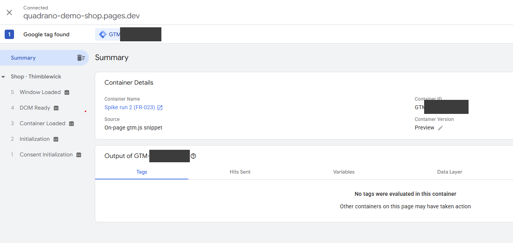
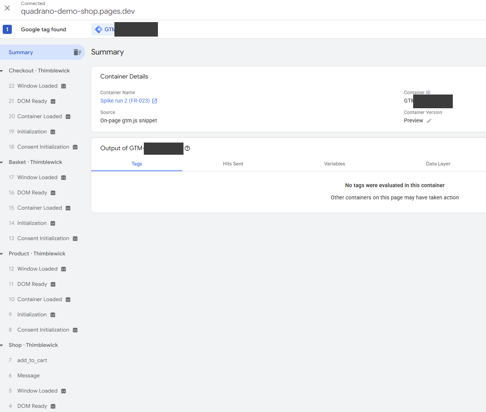
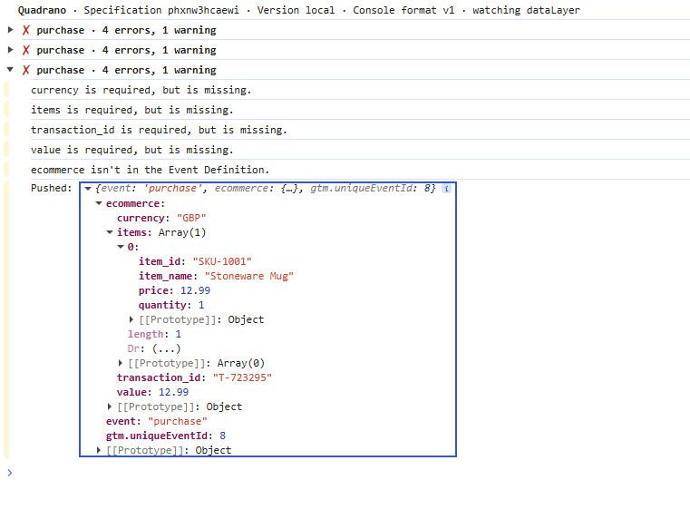

# Preview spike: a never-published container in GTM Preview (FR-023)

Mission `byo-gtm-container-01M64PAZ`, issue #4, "Check before building", item 1.

Container IDs are never written here. In the screenshots they're redacted as
`visitor GTM-****` (the test container) and `shop GTM-****` (the shop's own).

---

## Question

Does GTM Preview (Tag Assistant) connect to a container that has never been
published, when the shop injects that container while the page runs? Does it
stay connected across page navigations? If not, path 2 has to tell visitors to
publish their container.

## Run 1: before the feature exists (2026-10-29)

**Checked by:** the Product Owner.

**Set-up:** a brand-new, empty container in the Product Owner's own GTM account,
never published. Preview was started as the very first action after creating it,
targeting the production demo shop. The bring-your-own menu isn't built yet, so
the shop loaded only its own container, as it does today.

**Observed:**

| Check | Result |
|---|---|
| GTM lets you start Preview on a never-published container | **Yes.** Preview was available immediately after creating the container. |
| Tag Assistant connects to the demo shop | **Yes.** It shows "Connected" to the site. |
| The Tag Assistant session survives page navigations | **Yes.** It stayed connected from the product page to the basket page. |
| The test container runs on the page | **No, as expected.** Tag Assistant reports "Google Tag: GTM-**** not found … verify that the tag is installed on this page" on every page. The shop's own container is the only one found on the page. |
| Tags fire | Not applicable: the test container is empty. |

**What the two container IDs mean:** Tag Assistant shows a chip for the
container being previewed and one for each container it finds on the page.
The test container was **not** added to the page. It was listed because it
was being previewed, and marked "not found" because the page doesn't load it.

## Conclusion so far

- **Settled:** publishing is not needed to *start* Preview, and a Preview session
  on the demo shop persists across navigations.
- **Still open:** whether the never-published container *runs* in Preview once
  the shop itself loads it. This can only be checked once the shop can load a
  visitor's container (FR-006 to FR-008). The usual GTM workflow (install the
  snippet, Preview, publish later) relies on exactly this, so it is expected to
  work.
- **Path 2's visitor instructions (FR-024)** stay provisional until run 2.

## Run 2: with the feature built (2026-10-30)

The six steps below were checked against the built UI on 2026-10-29 (commit
`87d1c61`) and still match: the toggle and panel are labelled "Demo menu", the
path 2 heading is "Let me bring my own GTM container", the save button is
"Save", and the banner reads "Using your container GTM-XXXXXXX". No wording
change was needed.

On a preview deployment of the mission branch:

1. Create a fresh, empty, never-published container.
2. Enter its ID in the visitor menu; confirm the banner shows it.
3. Start Preview on the demo shop.
4. Check that Tag Assistant shows the test container as **found** (not "not found"),
   and that the shop's own container is **not** found (FR-001).
5. Navigate across at least three pages; check that it stays found on each.
6. Add a Quadrano Local snippet in a Custom HTML tag, refresh Preview, and use
   the playground: check that the Console shows a ✓ group and a ✗ group (SC-007).

**Checked by:** the Product Owner, on 2026-10-30, using Chrome 156.

**Set-up:**
- A new, empty container named "Spike run 2 (FR-023)" in the Product Owner's own
  GTM account. It was never published.
- The Pages preview of `feat/byo-gtm-container` at commit `5c9b429`
  (`feat-byo-gtm-container.quadrano-demo-shop.pages.dev`).

The container ID was entered through the Demo menu's path 2.

### Result (run 2)

| Step | Check | Result |
|---|---|---|
| 4 | Tag Assistant finds the test container, and not the shop's own (FR-001) | **Pass.** "1 Google tag found": the test container, with Container Version "Preview" and Source "On-page gtm.js snippet". The shop's container is not listed. |
| 5 | The test container stays found across pages | **Pass.** It was found on Shop, Product, Basket and Checkout, with `add_to_cart` recorded on the way. |
| 6 | The Quadrano Local snippet runs from the unpublished container, and the playground produces Console groups | **Pass, with one finding.** The snippet ran unpublished: the Console header reads "Quadrano · Specification … · Version local · Console format v1 · watching dataLayer", and the playground pushes produced ✗ groups. The ✓ check was not met; see below. |

Screenshots, with the container IDs redacted:

**Finding (step 6): `purchase · correct` gave ✗, not ✓.** The Console reports
"4 errors, 1 warning":
- currency, items, transaction_id and value are each "required, but is
  missing".
- "ecommerce isn't in the Event Definition."

The pushed object in the same screenshot matches the agreed contract: the four
fields sit under `ecommerce`, with currency GBP, value 12.99, one item and a
`T-` transaction ID. The broken scenarios' expected messages use the
`ecommerce.` paths too (`ecommerce.value is required, but is missing.`). So the
shop's push is correct, and the Specification used for the run expects these
fields at the top level of the event instead of under `ecommerce`. This is
outside this repository. It is either a defect in how quadrano.com/local
builds a GA4 `purchase` Specification, or the Specification needs its fields
defined under `ecommerce`. The Product Owner considers it a /local defect.

### Conclusion (run 2)

**FR-023: settled.** A never-published container runs in GTM Preview once the
shop loads it:
- Tag Assistant finds it.
- It stays found across navigations.
- Its Custom HTML tag runs.

Visitors don't need to publish.

**SC-007 is still open.** It needs a ✓ and a ✗ group, and only ✗ was seen,
because of the Specification finding above. A Specification that validates the
`ecommerce` fields must be available before the production rehearsal (NFR-006,
SC-007). That rehearsal is due before rehearsals finish on Thu 19 Nov 2026
(C-006).

### Path 2 copy (FR-024)

Run 2 passed, so the shipped copy for step 5 is final:

> Start Preview on this shop. You don't need to publish.

No code change is needed.
