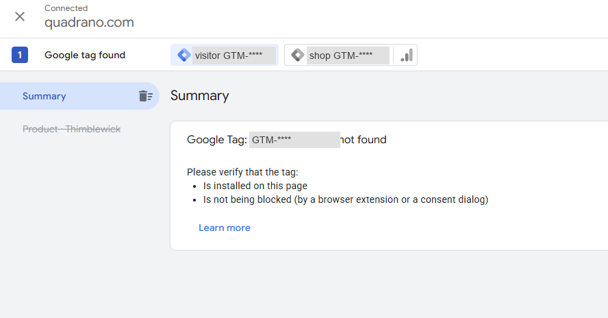
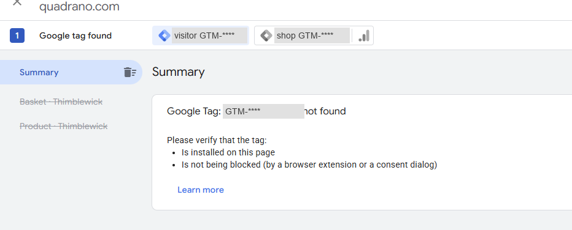

# Preview spike: a never-published container in GTM Preview (FR-023)

Mission `byo-gtm-container-01M64PAZ`, issue #4, "Check before building", item 1.

Container IDs are never written here. In the screenshots they're redacted as
`visitor GTM-****` (the test container) and `shop GTM-****` (the shop's own).

---

## Question

Does GTM Preview (Tag Assistant) connect to a container that has never been
published, when the shop injects that container while the page runs? Does it
stay connected across page navigations? If not, path 2 has to tell visitors to
publish their container.

## Run 1: before the feature exists (2026-10-29)

**Checked by:** the Product Owner.

**Set-up:** a brand-new, empty container in the Product Owner's own GTM account,
never published. Preview was started as the very first action after creating it,
targeting the production demo shop. The bring-your-own menu isn't built yet, so
the shop loaded only its own container, as it does today.

**Observed:**

| Check | Result |
|---|---|
| GTM lets you start Preview on a never-published container | **Yes.** Preview was available immediately after creating the container. |
| Tag Assistant connects to the demo shop | **Yes.** It shows "Connected" to the site. |
| The Tag Assistant session survives page navigations | **Yes.** It stayed connected from the product page to the basket page. |
| The test container runs on the page | **No, as expected.** Tag Assistant reports "Google Tag: GTM-**** not found … verify that the tag is installed on this page" on every page. The shop's own container is the only one found on the page. |
| Tags fire | Not applicable: the test container is empty. |

**What the two container IDs mean:** Tag Assistant shows a chip for the
container being previewed and one for each container it finds on the page.
The test container was **not** added to the page. It was listed because it
was being previewed, and marked "not found" because the page doesn't load it.

## Conclusion so far

- **Settled:** publishing is not needed to *start* Preview, and a Preview session
  on the demo shop persists across navigations.
- **Still open:** whether the never-published container *runs* in Preview once
  the shop itself loads it. This can only be checked once the shop can load a
  visitor's container (FR-006 to FR-008). The usual GTM workflow (install the
  snippet, Preview, publish later) relies on exactly this, so it is expected to
  work.
- **Path 2's visitor instructions (FR-024)** stay provisional until run 2.

## Run 2: with the feature built (pending the Product Owner)

The six steps below were checked against the built UI on 2026-10-29 (commit
`87d1c61`) and still match: the toggle and panel are labelled "Demo menu", the
path 2 heading is "Let me bring my own GTM container", the save button is
"Save", and the banner reads "Using your container GTM-XXXXXXX". No wording
change was needed.

On a preview deployment of the mission branch:

1. Create a fresh, empty, never-published container.
2. Enter its ID in the visitor menu; confirm the banner shows it.
3. Start Preview on the demo shop.
4. Check that Tag Assistant shows the test container as **found** (not "not found"),
   and that the shop's own container is **not** found (FR-001).
5. Navigate across at least three pages; check that it stays found on each.
6. Add a Quadrano Local snippet in a Custom HTML tag, refresh Preview, and use
   the playground: check that the Console shows a ✓ group and a ✗ group (SC-007).

**Status: not yet run.** Run 2 needs the Product Owner's real GTM account, the
Tag Assistant interface and the Pages preview of `feat/byo-gtm-container`. The
mission branch has not been pushed yet (the push needs the Product Owner's
go-ahead), so there is no preview deployment to run against. The result and
redacted `docs/spike/run2-*.png` screenshots will be added here once the
Product Owner runs the six steps.

### Result (run 2)

| Check | Result |
|---|---|
| Run 2 executed | **Not yet.** Pending the Product Owner and a Pages preview. |

### Conclusion (run 2)

**Pending.** Whether a never-published container runs in Preview once the shop
loads it is still open. The spec assumes run 2 passes (the usual
install-then-Preview-then-publish GTM workflow); if it does not, path 2's step 5
changes and nothing else.

### Path 2 copy (FR-024)

Run 2 has not produced a result, so the path 2 copy stays as shipped
(provisional, matching the spec's assumption that run 2 passes). Final copy of
step 5:

> Start Preview on this shop. You don't need to publish.

If run 2 shows the container does not run unpublished, step 5 becomes exactly
"Submit and publish your container, then reload this page." (contract), as a
one-constant change to `PREVIEW_STEP` in `site/src/menu/visitor-menu.ts`.
