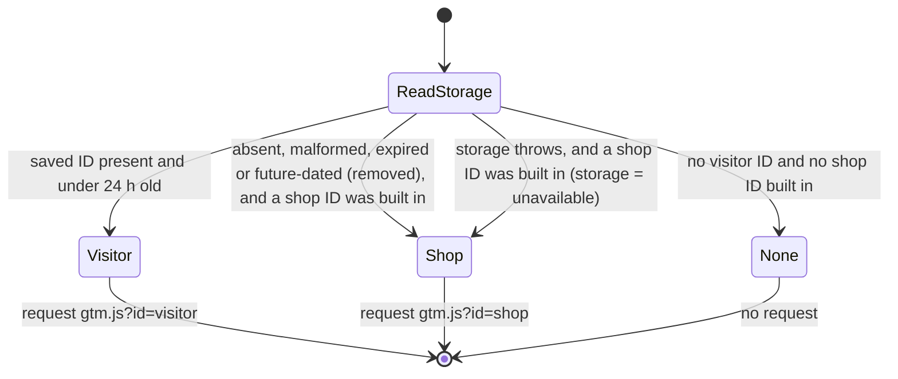

# Data Model: Bring your own GTM container

There is no server data. Everything below lives in the visitor's own browser (C-001) or is derived on each page load.

## Saved container ID (value object, persisted)

| Field | Type | Rule |
|---|---|---|
| storage key | constant | `demo-shop:visitor-container` in `localStorage` (research R-02) |
| `id` | string | matches `^GTM-[A-Z0-9]{4,10}$`, case-sensitive, no trimming at read time |
| `savedAt` | integer (epoch ms) | `Date.now()` when saved |

Serialised as `JSON.stringify({ id, savedAt })`.

**Validity** (all must hold, otherwise the value is *absent*):
- it parses as JSON, as an object with exactly the keys `id` and `savedAt`;
- `id` matches the pattern;
- `savedAt` is a finite integer and `0 ≤ now − savedAt < 86 400 000` (24 h, FR-011).

**Invariants**:
- It is written only by a submit on the menu's path 2 form with a well-formed ID (FR-006, C-005).
- It is never written, changed or cleared because of anything in the page address (FR-013).
- An absent-but-present value (malformed, expired, dated in the future) is removed on the next page load (R-03).

## Active container (derived, per page load)

| Field | Values | Set by |
|---|---|---|
| source | `visitor` \| `shop` \| `none` | the head loader |
| id | the visitor's ID, the shop's build-time ID, or none | the head loader |
| storage | `ok` \| `unavailable` | the head loader (any storage throw makes it `unavailable`) |

Exposed to page code as attributes on `<html>`. See [contracts/container-choice.md](contracts/container-choice.md).

**Choice** (evaluated once, synchronously, before any page module runs; FR-002):

**Invariant (FR-001, NFR-001)**: at most one `gtm.js` request is made per page load, and exactly one when a visitor or shop ID exists. The `<noscript>` iframe uses only the shop's ID (FR-004).

## Visitor menu state (in memory, per page)

| State | Transitions | Push? |
|---|---|---|
| closed | open (button) | none |
| open | close (button, close control, Escape); path 1; path 2 submit; reset; playground press | **only a playground press pushes** |

Path transitions on the saved ID:

| From | Action | Result | Page |
|---|---|---|---|
| any | path 2 submit, well-formed ID, storage ok | save `{id, now}` and verify by reading it back | reload |
| any | path 2 submit, malformed ID | nothing saved; refusal message; focus stays in the input | no reload |
| any | path 2 submit, storage unavailable | nothing saved; unavailable note | no reload |
| visitor | reset (banner or menu), or path 1 | key removed | reload |
| shop or none | path 1 | nothing to remove; menu says the shop's container is in use | no reload |

FR-017: none of these transitions pushes.

## Playground push (value object, transient)

One of the 7 existing pushes. The full mapping is in [contracts/playground-pushes.md](contracts/playground-pushes.md).

| Field | Value |
|---|---|
| line | the hero product (`SKU-1001`, Stoneware Mug, 1299 pence, quantity 1) |
| transaction id | `newTransactionId()` for each `purchase` press |
| scenario | fixed per button; independent of `?scenario=` |

**Invariants**: one press calls exactly one `push.ts` function, which writes `{ ecommerce: null }` followed by the event (FR-015). A press doesn't change the address, the scenario switcher, the basket or the order store.
