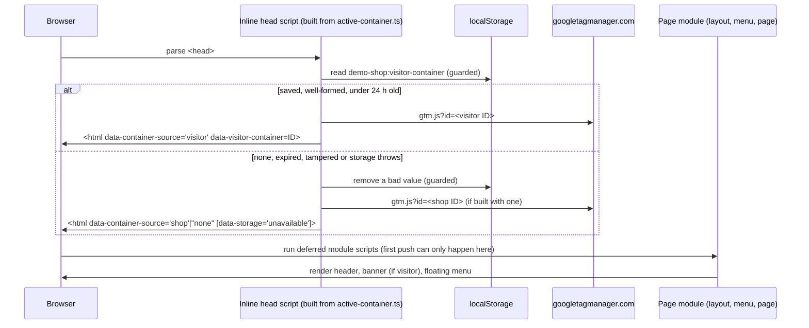

# Implementation Plan: Bring your own GTM container

**Branch**: `feat/byo-gtm-container` (planning base and merge target; reaches `main` by PR) | **Date**: 2026-10-29 | **Spec**: [spec.md](spec.md)
**Input**: Mission specification from `kitty-specs/byo-gtm-container-01M64PAZ/spec.md`

Planning decisions: `DM-01M64TAJ14KYVH94V2RCQPC8AY` (test tooling: Playwright and axe, in the 1.1.0 amendment). Engineering alignment confirmed by the Product Owner on 2026-10-29.

## Summary

Each page loads exactly one GTM container, chosen by a small inline script in `<head>` before any page module runs. The script picks the visitor's container if a well-formed ID under 24 hours old is saved in `localStorage`; otherwise it picks the shop's own container (ID baked in at build time from the hosting environment, as today); otherwise it loads none. The choice rules live in one file with no imports, which the build inlines and the menu imports. A floating visitor menu, mounted by the shared layout on all 5 pages, offers path 1 (the shop's container), path 2 (enter an ID) and an event playground. Its 7 buttons call the existing `push.ts` functions, so push shapes are unchanged by construction. A banner shows the visitor's container and offers a reset. Charter 1.1.0 amends QDR-002 for the one-container rule and adds Playwright and axe as dev-only tooling. A non-gate `pnpm test:e2e` proves the automatable NFRs (NFR-001 to NFR-003 and NFR-005) without ever requesting a real container; NFR-004 (Lighthouse mobile LCP) and NFR-006 (production rehearsal) stay manual.



## Technical Context

**Language/Version**: TypeScript 5.9.3 (erasable syntax only), run by Node 24.15.0 for scripts; browser target ES2023
**Primary Dependencies**: Vite 8.3.4 (multi-page static build, existing `quadrano-gtm` plugin extended; `transformWithOxc` strips types from the loader). No runtime dependencies. New dev-only: `@playwright/test` 1.64.1 and `@axe-core/playwright` 4.14.0 (Charter 1.1.0)
**Storage**: Browser `localStorage`, one key `demo-shop:visitor-container` holding `{"id":"GTM-…","savedAt":<epoch ms>}`; no server storage (C-001)
**Testing**: The four gates are unchanged (lint, build, no-secrets, provenance). Non-gate checks: `pnpm verify:container` (`node:assert`, pure choice rules, ≥10 malformed IDs, expiry and tamper cases, and the no-secrets scanner still flagging a real-looking ID); `pnpm verify:scenarios` (unchanged); `pnpm test:e2e` (Playwright Chromium plus axe; googletagmanager.com is intercepted and counted). Manual: Lighthouse mobile run (NFR-004), production rehearsal (NFR-006), Preview spike run 2 (FR-023)
**Target Platform**: Static site on Cloudflare Pages at `demo.quadrano.com`; evergreen desktop and mobile browsers; Chrome is used for GTM Preview
**Project Type**: single (static multi-page web site)
**Performance Goals**: LCP ≤ 2 s per page (Lighthouse mobile, Slow 4G) with the menu present and closed (NFR-004); loader is a few hundred bytes inline, and the menu adds no extra request
**Constraints**: exactly one container request per page load (NFR-001); container chosen before the first push (FR-002); the page address is never read for the container (FR-013); no container-ID-shaped literal in tracked files except `GTM-XXXXXXX` (FR-019); no verdict wording in `site/` (FR-022, existing lint); 0 px horizontal overflow at 360 px (NFR-003); land before Thu 19 Nov 2026 (C-006)
**Scale/Scope**: 5 pages, 1 storage key, 7 playground buttons, about 6 new source files, 1 Charter minor amendment

## Charter Check

*GATE: Must pass before Phase 0 research. Re-checked after Phase 1 design.*

| Rule | Status | How the plan holds it |
|---|---|---|
| QDR-001 Provenance | Pass | All code original; Playwright (Apache-2.0) and axe-core (MPL-2.0) are public, used unmodified as dev tools and not shipped. No prior venture named. |
| QDR-002 Approved stack | **Pass after amendment** | Loading a visitor's container and adding dev dependencies both need 1.1.0 (FR-025, `DM-01M64RAA19WKDR4DQ969WWGG9A`, `DM-01M64TAJ14KYVH94V2RCQPC8AY`). The amendment lands in this mission before, or in the same PR as, the code that relies on it. Still static, with no backend. |
| QDR-003 Minimal gates | Pass | Gate set and order unchanged. `test:e2e` and `verify:container` are explicitly non-gate, as `verify:scenarios` is. |
| QDR-004 No secrets | Pass | The shop ID stays in `VITE_GTM_CONTAINER_ID`. Tests build IDs at run time. The no-secrets scanner is refactored to be importable, not weakened, and a check proves it still fires (FR-019). |
| QDR-005 Contract | Pass | No new events, variants or Attributes. The playground calls the existing builders and `push.ts`. |
| QDR-006 Escalation | Pass | The spike run 2 result is a Product Owner step. If it fails, the change is limited to the path 2 copy (FR-024). |
| QDR-007 Amendments | Pass | Minor 1.1.0: version and date, `charter.yaml` matches `charter.md`, reasoning in the commit, amendment log row, mechanism statement (see [research.md](research.md) R-09). Proposed by the Architect; the Product Owner approved the shape (`DM-01M64RAA19WKDR4DQ969WWGG9A`). |
| Terminology Canon | Pass | No new domain terms. "Container" is the vendor's term; UI copy uses "Attribute" where needed and avoids the banned synonyms. |
| DIRECTIVE_051 Supply chain | Pass (advisory) | All five controls recorded for both new packages in [research.md](research.md) R-08. The adversarial squad pass is deferred, with the rationale recorded there. |

Post-design re-check (after Phase 1): no new violations. The one exemption-shaped item is that `vite.config.ts` keeps emitting the GTM `gtm.start` push inside the inline snippet, as it does today. `site/src/container/active-container.ts` never touches `dataLayer`, so the FR-016 lint rule needs no exemption.

## Project Structure

### Documentation (this mission)

```
kitty-specs/byo-gtm-container-01M64PAZ/
├── spec.md
├── plan.md              # this file
├── research.md          # Phase 0: R-01 … R-10
├── data-model.md        # Phase 1: saved container ID, active container, playground push
├── quickstart.md        # Phase 1: run, verify, rehearse
├── contracts/
│   ├── container-choice.md   # loader, storage value, <html> data attributes
│   ├── visitor-menu.md       # menu, banner, a11y and copy contract
│   └── playground-pushes.md  # 7 buttons → existing push contract
└── tasks.md             # /spec-kitty.tasks (not created here)
```

### Source Code (repository root)

```
site/
├── *.html, */index.html          # unchanged markers <!-- gtm:head --> / <!-- gtm:body -->
└── src/
    ├── container/
    │   ├── active-container.ts   # NEW, self-contained: key, ID pattern, expiry, parse/choose (inlined into <head> and imported by the menu)
    │   └── visitor-storage.ts    # NEW: guarded localStorage save/clear/probe (no memory fallback)
    ├── menu/
    │   ├── visitor-menu.ts       # NEW: floating button and disclosure panel, path 1 and 2, storage-unavailable note
    │   ├── banner.ts             # NEW: "Using your container GTM-…" and reset
    │   └── playground.ts         # NEW: 7 buttons calling push.ts
    ├── datalayer/                # unchanged (push.ts stays the only dataLayer writer)
    ├── switcher/                 # unchanged
    └── ui/
        ├── layout.ts             # mounts banner and menu once per page
        └── styles.css            # floating button, panel, banner; 360 px rules
vite.config.ts                    # quadrano-gtm plugin: inline loader plus shop ID; noscript still shop-only
scripts/
├── lib/secret-scan.ts            # NEW: scanText extracted from no-secrets.ts (behaviour identical)
├── no-secrets.ts                 # imports lib/secret-scan.ts
└── verify-container.ts           # NEW: pnpm verify:container
e2e/                              # NEW: Playwright specs (container, menu, playground, a11y, layout)
playwright.config.ts              # NEW: builds to .e2e-dist with a run-time-built shop ID; Chromium
.kittify/charter/charter.md, charter.yaml   # 1.1.0
AGENTS.md                         # dev deps, commands, browser install
kitty-specs/demo-shop-01M5QW5Y/contracts/datalayer-pushes.md   # playground note (FR-026)
kitty-specs/demo-shop-01M5QW5Y/spec.md      # NFR-004, C-011, FR-003 annotated "scoped by Charter 1.1.0"
docs/spike/preview-spike.md       # run 2 (Product Owner)
```

**Structure Decision**: Single static project, extending the existing `site/src` layout with two folders, `container/` (choice rules and storage) and `menu/` (UI). The layout mounts the menu, so no page entry module (`site/src/pages/*.ts`) changes. Tests sit in a top-level `e2e/` folder outside `site/`, so the shop lint rules don't apply to them. `tsconfig.json` `include` and the ESLint ignores gain `e2e/**`, `playwright.config.ts`, `.e2e-dist/`, `test-results/` and `playwright-report/` as appropriate.

## Complexity Tracking

| Violation | Why Needed | Simpler Alternative Rejected Because |
|---|---|---|
| New dev dependencies (Playwright, axe) under QDR-002 | NFR-001 needs 100 page loads checked 10 times over; NFR-002 asks for automated accessibility checks | A manual DevTools checklist (option B in `DM-01M64TAJ14KYVH94V2RCQPC8AY`) is slow and error-prone at that volume before 19 Nov; rejected by the Product Owner |
| Inlining a TS module into `<head>` at build time | FR-002 needs the choice made synchronously before module scripts; the menu needs the same rules | A separate blocking `<script src>` adds a render-blocking request (NFR-004); hand-written JS in `vite.config.ts` duplicates the rules the menu needs |

## Implementation Concern Map

> Implementation concerns are not work packages. `/spec-kitty.tasks` translates them.

### IC-01 — Charter 1.1.0 and tooling record

- **Purpose**: Make the rulebook allow exactly one container per page (the shop's or the visitor's, never one from the address) and the new dev tooling, before code relies on either.
- **Relevant requirements**: FR-025, FR-003, C-002, C-008; `DM-01M64RAA19WKDR4DQ969WWGG9A`, `DM-01M64TAJ14KYVH94V2RCQPC8AY`
- **Affected surfaces**: `.kittify/charter/charter.md`, `.kittify/charter/charter.yaml`, `AGENTS.md`, `kitty-specs/demo-shop-01M5QW5Y/spec.md` (annotations only)
- **Sequencing/depends-on**: none (goes first)
- **Risks**: `charter.md` and `charter.yaml` drifting apart; the Policy Summary headings must stay verbatim, because Spec Kitty reads them.

### IC-02 — Container choice and loader

- **Purpose**: Choose and load exactly one container per page before the first push, reading only `localStorage`, never the address.
- **Relevant requirements**: FR-001, FR-002, FR-003, FR-004, FR-011, FR-012, FR-013, C-005; NFR-001
- **Affected surfaces**: `site/src/container/active-container.ts`, `site/src/container/visitor-storage.ts`, `vite.config.ts`
- **Sequencing/depends-on**: IC-01
- **Risks**: the inlined code must stay self-contained (no imports, no references to outside names), and a build-time check must fail if it isn't. ID validation must happen before it is placed in a URL. Storage access can throw on `localStorage` property access itself, not just on get and set.

### IC-03 — Visitor menu and banner

- **Purpose**: A floating, accessible menu on every page with path 1 and path 2, the refusal message, the storage-unavailable note and the path 2 instructions; plus the banner with reset.
- **Relevant requirements**: FR-005 to FR-010, FR-012, FR-017, FR-020, FR-021, FR-022, FR-024; NFR-002, NFR-003, NFR-005
- **Affected surfaces**: `site/src/menu/visitor-menu.ts`, `site/src/menu/banner.ts`, `site/src/ui/layout.ts`, `site/src/ui/styles.css`
- **Sequencing/depends-on**: IC-02 (choice rules), IC-04 (playground module)
- **Risks**: lint forbids verdict wording, so the copy must avoid "valid", "invalid", "pass" and "fail" (see [contracts/visitor-menu.md](contracts/visitor-menu.md)). Focus handling and the 360 px layout are where accessibility regressions hide. The path 2 copy may change after spike run 2.

### IC-04 — Event playground

- **Purpose**: 7 buttons, each making exactly one existing push (after the ecommerce clear) through `push.ts`.
- **Relevant requirements**: FR-014, FR-015, FR-016, FR-017, FR-018, FR-026, C-003; NFR-005, NFR-006
- **Affected surfaces**: `site/src/menu/playground.ts`, `kitty-specs/demo-shop-01M5QW5Y/contracts/datalayer-pushes.md`
- **Sequencing/depends-on**: none (the module is self-contained; IC-03 imports it)
- **Risks**: an accidental double push from duplicate listeners if the menu mounts twice; the playground must not write the scenario to the address or touch the order store.

### IC-05 — Verification

- **Purpose**: Prove the NFRs and success criteria with non-gate checks, keeping the no-secrets gate as strict as it is.
- **Relevant requirements**: FR-019; NFR-001 to NFR-003, NFR-005; SC-001 to SC-006, SC-008
- **Affected surfaces**: `scripts/lib/secret-scan.ts`, `scripts/no-secrets.ts`, `scripts/verify-container.ts`, `e2e/**`, `playwright.config.ts`, `package.json`, `pnpm-lock.yaml`, `tsconfig.json`, `eslint.config.js`, `.gitignore`
- **Sequencing/depends-on**: IC-01 (dependencies approved); exercises IC-02 to IC-04
- **Risks**: the lockfile change must be reviewed like a manifest change. The e2e build must never use a real container ID, and its output must never be committed.

### IC-06 — Preview spike run 2 and evidence (Product Owner)

- **Purpose**: Record whether a never-published visitor container runs in Preview on the built feature, and settle the path 2 copy.
- **Relevant requirements**: FR-023, FR-024; NFR-004, NFR-006; SC-007
- **Affected surfaces**: `docs/spike/preview-spike.md`, `docs/release-checks.md`, the path 2 copy in `site/src/menu/visitor-menu.ts`
- **Sequencing/depends-on**: IC-02 to IC-04 deployed to a Pages preview
- **Risks**: depends on the Product Owner's time before 19 Nov; screenshots must redact both IDs.
