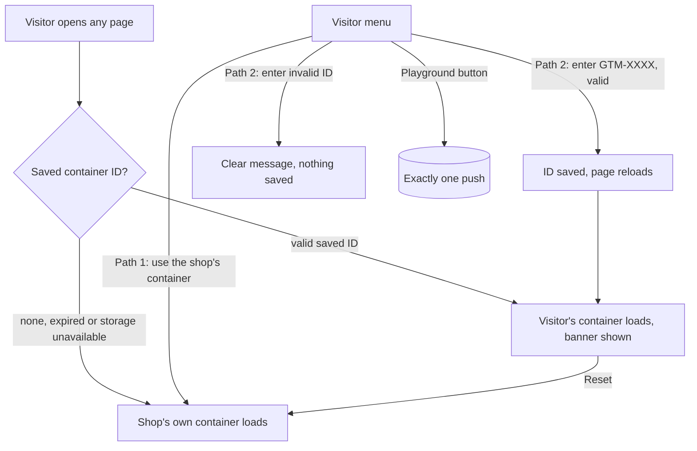

# Mission Specification: Bring your own GTM container

**Mission Branch**: `feat/byo-gtm-container`
**Created**: 2026-10-29
**Status**: Draft (intent confirmed by the Product Owner, 2026-10-29; awaiting spec approval)
**Input**: GitHub issue Quadrano-Ltd/quadrano-demo-shop#4, "Bring your own GTM container: a visitor menu with two demo paths and an event playground". Discovery decisions: `DM-01M64QQXR4F4SVZFMYSAVBWASB` (playground events), `DM-01M64RAA19WKDR4DQ969WWGG9A` (Charter amendment), `DM-01M64RE3AGCJS35SK4A5WW0H21` (Preview spike), `DM-01M64RG96F8V6JBVY0AM5SA009` (Console panel).

## Purpose

For the talk, the Product Owner wants to demo the whole create, deploy and inspect process for a brand-new Quadrano Local snippet on the demo shop, and to let attendees do the same for themselves on the day. Attendees can't edit the shop's own GTM container, so today the second goal is impossible.

This mission adds a visitor menu to every page with two paths: watch validation through the shop's own pre-built container, or bring your own empty GTM container, add a Quadrano Local snippet to it, and read the verdicts in GTM Preview. The menu also holds an event playground that makes the shop's existing correct and deliberately broken pushes on demand, so nobody has to go through checkout.

The shop still pushes data and never judges it (demo-shop-01M5QW5Y#FR-017). Every verdict a visitor sees is written by the Quadrano runtime.

Exactly one container loads on each page, before the page's first push. The page address can never choose the container.

## User Scenarios & Testing *(mandatory)*

### User Story 1 - Bring my own container (Priority: P1)

An attendee, or the presenter running the talk demo, has created an empty container in their own GTM account. On any page of the demo shop, they open the visitor menu, choose "Let me bring my own GTM container" and type its ID. The shop saves the ID, reloads, and from then on loads only their container on every page. A banner on each page says "Using your container GTM-XXXX" and offers a reset. They build a Specification on quadrano.com/local, paste the snippet into a Custom HTML tag in their container, start GTM Preview on the demo shop, and read ✓ and ✗ verdicts in the Console as they click around.

**Why this priority**: This is the reason for the mission. Without it, attendees can't take part and the presenter can't demo a fresh snippet.

**Independent Test**: Enter a test container ID in the menu, then check on every page that only that container is requested, that the banner shows it, and that reset restores the shop's own container.

**Acceptance Scenarios**:

1. **Given** no saved ID, **When** the visitor enters a well-formed container ID and confirms, **Then** the ID is saved, the page reloads, only that container loads, and the banner shows the ID.
2. **Given** a saved ID, **When** the visitor moves to any other shop page, **Then** that page also loads only the visitor's container and shows the banner.
3. **Given** a saved ID, **When** the visitor chooses reset, **Then** the saved ID is removed, the page reloads, only the shop's own container loads, and no banner shows.
4. **Given** any state, **When** the visitor enters a malformed ID (for example `GTM-12`, `gtm-abcd`, `UA-1234`, or an ID with spaces or extra characters), **Then** the shop refuses it with a clear message, saves nothing and keeps the current container.
5. **Given** the visitor's empty container with a Quadrano Local snippet in a Custom HTML tag, in GTM Preview and never published, **When** the visitor makes a correct and a broken push, **Then** the Console shows a ✓ group and a ✗ group from the Quadrano runtime. (This depends on the Preview spike; see Assumptions.)

---

### User Story 2 - Watch it with the shop's pre-built container (Priority: P1)

A visitor who doesn't want to set anything up opens the menu and chooses "Show me the output with the pre-built container". The shop uses its own container, which holds a published Quadrano tag for the Demo Shop Specification. The visitor opens the Console, clicks around or uses the playground, and sees each push validated.

**Why this priority**: It is the zero-setup path for most attendees, and it matches what the shop does today.

**Independent Test**: With no saved ID, load each page and check that only the shop's own container is requested. With a saved ID, choose path 1 and check that the saved ID is cleared and the shop's container is back.

**Acceptance Scenarios**:

1. **Given** no saved ID, **When** any page loads, **Then** only the shop's own container loads, exactly as it does today.
2. **Given** a saved ID, **When** the visitor chooses path 1, **Then** it behaves as reset (User Story 1, scenario 3).
3. **Given** the Product Owner has published the Quadrano tag in the shop's container, **When** the visitor makes a playground push, **Then** the Console shows the expected verdict group for that push.

---

### User Story 3 - Push events on demand from the playground (Priority: P1)

A visitor, or the presenter, opens the menu and uses the event playground. Its buttons push the seven existing pushes: correct `add_to_cart`, correct `purchase`, and the five deliberately broken `purchase` scenarios. Each button makes exactly one event push, shaped exactly as the existing data layer contract describes, so the visitor sees each verdict without going through the shop's checkout.

**Why this priority**: Visitors at a talk won't walk through checkout five times; the playground is how they reach every verdict quickly.

**Independent Test**: Press each playground button with the data layer observed, and check that each press adds exactly one event push of the documented shape, and that opening, closing or switching anything in the menu adds none.

**Acceptance Scenarios**:

1. **Given** the menu is open, **When** the visitor presses a playground button, **Then** exactly one event push is made, matching the contract for that push, with the usual ecommerce clear before it (demo-shop-01M5QW5Y#FR-006).
2. **Given** a talk-script link with `?scenario=…`, **When** the page opens, **Then** the named scenario is active, as demo-shop-01M5QW5Y#FR-013 says, and the on-page scenario control still works as demo-shop-01M5QW5Y#FR-014 says.
3. **Given** any page, **When** the visitor opens or closes the menu, switches path, resets, or changes scenario, **Then** no push is made.

---

### User Story 4 - Accessible at phone width (Priority: P2)

An attendee using a keyboard or a screen reader, or on a phone, can find, open, use and close the menu.

**Why this priority**: Talk attendees use whatever device they brought; an inaccessible control would exclude some of them.

**Independent Test**: Run an automated accessibility check with the menu open and closed, operate everything by keyboard alone, and check the layout at 360 px wide.

**Acceptance Scenarios**:

1. **Given** any page, **When** the visitor tabs to the floating button, **Then** it has a visible text label and a visible focus indicator, and announces whether the menu is expanded.
2. **Given** the menu is open, **When** the visitor presses Escape, **Then** the menu closes and focus returns to the button.
3. **Given** a 360 px wide viewport, **When** the menu is open, **Then** nothing overflows horizontally and every control is reachable.

---

### Edge Cases

- **Browser storage unavailable or blocked** (private mode, storage disabled, a read or write that throws): the shop loads its own container and the menu explains that bring-your-own is unavailable in this browser.
- **Saved ID older than 24 hours**: it is treated as absent and removed, and the shop's own container loads.
- **Saved value tampered with or malformed** (edited by hand in the browser): it is treated as absent and the shop's own container loads; it is never loaded as a container.
- **`?gtm=` or any other address parameter naming a container**: ignored, and the menu never offers a way to set the ID from a link.
- **Lower-case input** (`gtm-abc123`): refused. The ID must be entered exactly as GTM shows it.
- **Visitor enters the shop's own container ID**: treated like any other visitor ID; exactly one container still loads.
- **Shop's own container ID missing from the hosting environment** (for example a local build): with no saved ID, no container loads, as today; a saved visitor ID still works.
- **Path 1 used while the visitor also runs their own snippet elsewhere**: not possible on this site, since only one container loads; this is why the presenter demos through path 2 with a fresh container (path 1 would print duplicate verdicts).
- **JavaScript disabled**: the shop's own container still loads through the no-script fallback; the menu isn't available.

## Domain Language

The Terminology Canon applies unchanged. This mission adds no domain terms.

| Term | Use | Avoid |
|---|---|---|
| **Container** | A GTM container, identified by its `GTM-` ID (vendor term) | "tag manager account", "workspace" (a GTM workspace is a different thing) |
| **Shop's own container** | The demo shop's container, ID supplied by the hosting environment | "default container", "our GTM" |
| **Visitor's container** | A container whose ID the visitor typed into the menu | "custom container", "BYO GTM" in UI text |
| **Visitor menu** | The floating button and the menu it opens (UI name, not a domain term) | — |
| **Event playground** | The part of the visitor menu with one button per existing push (UI name, not a domain term) | "test events", "event tester" |

"Broken" remains a testing mode, not a domain term. Attributes are "Attributes", never "parameters" or "fields".

## Requirements *(mandatory)*

### Functional Requirements

| ID | Title | User Story | Priority | Status | Delivery | No-op passable? |
|----|-------|------------|----------|--------|----------|-----------------|
| FR-001 | One container per page | As the Product Owner, I want every page to load exactly one GTM container (the visitor's if a valid, unexpired ID is saved, otherwise the shop's own), never both, so that verdicts are never duplicated. This changes demo-shop-01M5QW5Y#FR-003. | High | Open | [build] | no — checked in both states on the same pages: with no saved ID only the shop's container is requested, with a saved ID only the visitor's is |
| FR-002 | Container ready before the first push | As a visitor, I want the chosen container to start loading before the page's first push, so that the Quadrano snippet sees every push, including the first. | High | Open | [build] | no — fails if the container is chosen after the page's own pushes run |
| FR-003 | Shop's ID stays out of the repo | As the Product Owner, I want the shop's own container ID still supplied only by the hosting environment and never stored in the repository (QDR-004), so that FR-001 doesn't reintroduce a secret. | High | Open | [ratchet] | yes — paired with FR-019's gate run on the same diff |
| FR-004 | No-script fallback | As a visitor without JavaScript, I want the shop's own container to load through the no-script fallback, as today, so that the no-JavaScript behaviour doesn't regress. | Medium | Open | [ratchet] | yes — paired with FR-001's saved-ID check on the same page |
| FR-005 | Visitor menu on every page | As a visitor, I want a floating, labelled button on every page that opens a menu with path 1, path 2 and the event playground, so that I can choose how to see validation. | High | Open | [build] | no |
| FR-006 | Path 2: enter my container ID | As a visitor, I want to type a container ID into the menu and, if it matches `GTM-` followed by 4 to 10 upper-case letters or digits, have it saved in my browser and the page reloaded, so that my container is used from then on. | High | Open | [build] | no |
| FR-007 | Malformed ID refused | As a visitor, I want a malformed ID refused with a clear message that shows the expected format, with nothing saved and the current container unchanged, so that a typo can't break the shop. | High | Open | [build] | no — paired with FR-006's well-formed ID on the same input field |
| FR-008 | Saved ID carries across pages | As a visitor, I want my saved ID to apply on every shop page, so that I can move through the shop in GTM Preview. | High | Open | [build] | no |
| FR-009 | Banner while my container is active | As a visitor, I want a banner on every page reading "Using your container GTM-XXXX" (my ID) while my container is active, so that I always know which container is running. | High | Open | [build] | no |
| FR-010 | Reset to the shop's container | As a visitor, I want a reset in the banner and in the menu that removes my saved ID and reloads, so that I can return to the shop's own container. Choosing path 1 does the same. | High | Open | [build] | no |
| FR-011 | Saved ID expires | As the Product Owner, I want a saved ID to stop applying 24 hours after it was saved, so that a forgotten or planted ID doesn't run indefinitely. | Medium | Open | [build] | no — paired with FR-008 on the same saved ID before expiry |
| FR-012 | Storage failure falls back | As a visitor, I want the shop to load its own container whenever browser storage can't be read or written, or holds a malformed value, and the menu to say bring-your-own is unavailable, so that the shop never breaks. | High | Open | [build] | no |
| FR-013 | Address can never set a container | As the Product Owner, I want no page address (query, fragment or path) ever to set, change or clear the container, so that nobody can send a link that runs their container's code on a quadrano.com subdomain for whoever opens it. | High | Open | [build] | no — checked against a link carrying a container ID while a saved ID is present and while none is |
| FR-014 | Event playground | As a visitor, I want one playground button for each of the seven existing pushes (correct `add_to_cart`, correct `purchase`, and the five broken `purchase` scenarios of demo-shop-01M5QW5Y#FR-007 to #FR-011), so that I can reach every verdict without checkout. | High | Open | [build] | no |
| FR-015 | One push per playground press | As a visitor, I want each playground press to make exactly one event push, preceded by the ecommerce clear, with exactly the shape the existing data layer contract documents for that push, so that each press maps to one Console group. | High | Open | [build] | no |
| FR-016 | No new events or Attributes | As the Product Owner, I want the playground to push nothing outside the existing data layer contract (no new events, variants or Attributes), so that the Demo Shop Specification in quadrano-web needs no change. | High | Open | [ratchet] | yes — paired with FR-015's shape check on the same pushes |
| FR-017 | Switching still pushes nothing | As the presenter, I want opening, closing or using the menu, entering an ID, resetting, and changing scenario to make no push (demo-shop-01M5QW5Y#FR-015), so that the Console shows only intended pushes. | High | Open | [ratchet] | yes — paired with FR-015 on the same page, where a press must push once |
| FR-018 | Scenario links still work | As the presenter, I want `?scenario=` links and the on-page scenario control to behave exactly as demo-shop-01M5QW5Y#FR-013 and #FR-014 say, whether the playground sits beside the switcher or absorbs it, so that the talk script's links still work. | High | Open | [ratchet] | yes — paired with a link naming a non-default scenario, which must change the active scenario |
| FR-019 | No real-looking container IDs in tracked files | As the Product Owner, I want the no-secrets gate (demo-shop-01M5QW5Y#FR-019) to keep failing on any real-looking container ID in a tracked file, with tests and docs using only an agreed placeholder that the gate accepts, or IDs built while tests run, so that this mission doesn't weaken QDR-004. | High | Open | [build] | no — the gate must still fail on a fixture containing a real-looking ID |
| FR-020 | Accessible menu | As a visitor using a keyboard or screen reader, I want the floating button to be a real button with a visible label and an expanded/collapsed state, Escape to close the menu, and focus moved into the menu on open and back to the button on close, so that I can use it without a mouse. | Medium | Open | [build] | no |
| FR-021 | Works at phone width | As an attendee on a phone, I want the button, menu and banner to work at 360 px wide with nothing overflowing, so that I can use path 1 and the playground from my phone. | Medium | Open | [build] | no |
| FR-022 | No shop verdicts | As the Product Owner, I want the menu, banner, playground and their messages to contain nothing verdict-like (demo-shop-01M5QW5Y#FR-017), so that every verdict seen is Quadrano's own. | High | Open | [ratchet] | yes — paired with FR-007's refusal message, which must be shown but must not use verdict symbols |
| FR-023 | Preview spike recorded | As the Product Owner, I want the check of whether GTM Preview runs a never-published container that the shop loads while the page runs, and keeps it running across page navigations, recorded with redacted screenshots in `docs/spike/preview-spike.md`, so that path 2's visitor instructions are based on evidence. Run 1 (before the feature) is recorded; run 2 (on the built feature) must be recorded before path 2's instructions are finalised. | High | Open | [build] | no |
| FR-024 | Path 2 instructions follow the spike | As a visitor, I want path 2's instructions in the menu to tell me to stay in Preview without publishing if the spike passed, or to publish my container if it failed, so that the steps I follow actually work. | High | Open | [build] | no |
| FR-025 | Charter amendment 1.1.0 | As the Product Owner, I want Charter QDR-002 amended (minor, 1.1.0) in this mission to allow exactly one GTM container per page, either the shop's own or one the visitor enters in the menu and never one taken from the page address, with NFR-004 and C-011 of the demo-shop mission scoped to the shop's own container, following QDR-007, so that the rulebook matches the shop. | High | Open | [build] | no |
| FR-026 | Push contract notes the playground | As an implementer, I want the data layer contract to record that the playground makes the same seven pushes, with the same shapes, as the shop's actions and scenarios, so that the contract stays the single description of every push. | Medium | Open | [build] | no |

### Non-Functional Requirements

| ID | Title | Requirement | Category | Priority | Status |
|----|-------|-------------|----------|----------|--------|
| NFR-001 | One container, proven | An end-to-end test run in both states (no saved ID; a saved ID) across all 5 shop pages observes exactly 1 container request per page load and 0 requests for the other container, in 10 out of 10 runs. | Reliability | High | Open |
| NFR-002 | Accessibility | Automated accessibility checks report 0 violations on every page with the menu open and with it closed; 100% of menu, banner and playground controls work by keyboard alone. | Accessibility | High | Open |
| NFR-003 | Phone width | At a 360 px wide viewport, every page with the menu open or closed and the banner shown has 0 px of horizontal overflow. | Usability | Medium | Open |
| NFR-004 | Page speed holds | Each page's Largest Contentful Paint stays at most 2 seconds (Lighthouse mobile, default Slow 4G throttling), with the menu present and closed, matching demo-shop-01M5QW5Y#NFR-001. | Performance | Medium | Open |
| NFR-005 | Fast to any verdict | From any page, a visitor reaches any of the 7 pushes in at most 2 interactions (open menu, press button). | Usability | High | Open |
| NFR-006 | Repeatable verdicts both paths | In a pre-rehearsal check, each of the 7 playground pushes produces its expected Console group in 10 out of 10 runs on production, through path 1 and through path 2 (with a fresh, empty container and a Quadrano Local snippet). | Reliability | High | Open |

### Constraints

| ID | Title | Constraint | Category | Priority | Status |
|----|-------|------------|----------|----------|--------|
| C-001 | Static only | No backend, accounts or database (QDR-002); the visitor's ID lives only in the visitor's own browser. | Technical | High | Open |
| C-002 | No secrets in repo | The shop's own container ID stays only in the hosting environment (QDR-004); the no-secrets gate is not weakened. | Security | High | Open |
| C-003 | Contract unchanged | No new events, variants or Attributes; the published-artefact contract v1.0 and the Demo Shop Specification are untouched (QDR-005). | Business | High | Open |
| C-004 | quadrano-web untouched | No change to `quadrano-web`. Rewriting its help doc "Installing the snippet in GTM" for path 2 is a separate follow-up there. | Business | High | Open |
| C-005 | Container ID only from the menu | A container ID comes only from the visitor typing it into the menu; never from a link, the page address, another site or a stored default. | Security | High | Open |
| C-006 | Dates | This work, the Charter amendment and the Product Owner's container step land before rehearsals finish on Thu 19 Nov 2026 (demo-shop-01M5QW5Y#C-008). | Business | High | Open |
| C-007 | Gates | Every push passes lint, build, no-secrets and provenance (QDR-003). | Technical | High | Open |
| C-008 | Provenance and terminology | QDR-001 and the Terminology Canon apply unchanged; no new domain terms. | Legal | High | Open |
| C-009 | Out of scope | Not built here: an on-page Console panel; setting the container from the page address; new event types or variants; publishing the Quadrano tag in the shop's container (Product Owner step). | Business | High | Open |

### Key Entities

- **Saved container ID**: the ID a visitor entered, kept only in their own browser, with the time it was saved. Valid only if well-formed and less than 24 hours old.
- **Active container**: the single container a page loads: the visitor's if a valid saved ID exists, otherwise the shop's own.
- **Playground push**: one of the seven existing pushes, triggered from the menu; identical in shape to the same push made by the shop's actions and scenarios.

## Assumptions and Dependencies

- **Preview spike (FR-023) runs in two parts.** Run 1 (Product Owner, 2026-10-29, `docs/spike/preview-spike.md`): GTM allows Preview on a never-published container immediately after creating it, and the Tag Assistant session on the demo shop survives page navigations. The test container was reported "not found" on the page, as expected, because the shop can't load a visitor's container yet. Run 2 checks that the never-published container actually runs once the shop loads it; it can only happen on the built feature, and it gates path 2's instructions, not the rest of implementation. The spec assumes run 2 passes, as the usual install-then-Preview-then-publish GTM workflow relies on this. If it fails, path 2 tells the visitor to publish their container (FR-024), and nothing else in this spec changes. The Product Owner runs both parts, since they need a real GTM account and the Tag Assistant interface.
- **Sign-in cookie exposure: accepted by the Product Owner, not pursued now.** Issue #4 asks whether script on `demo.quadrano.com` can read or set quadrano.com's sign-in cookies. A read-only check found only a host-only `NEXT_LOCALE` cookie on quadrano.com's public pages; signed-in cookies were not checked. On 2026-10-29 the Product Owner judged the risk too fringe to act on at this stage. FR-011 (24-hour expiry), FR-009 (banner) and FR-013 (address can't set a container) limit exposure regardless.
- **Product Owner step, not for the agents:** publish a Quadrano Local tag with the Demo Shop Specification in the shop's own container, needed for path 1 (User Story 2, scenario 3).
- **Depends on** Charter 1.0.1 (✓/✗ wording), which reaches `main` through PR #5 before this mission's PR.
- **Saved-ID expiry of 24 hours** is the Product Owner-confirmed default; it covers a full rehearsal or talk day.
- **The presenter demos through path 2** with a fresh container; path 1 would print duplicate verdicts if the presenter's own snippet were also present.
- Whether the playground absorbs the scenario switcher or sits beside it is left to the plan, provided FR-018 holds.

## Success Criteria *(mandatory)*

### Measurable Outcomes

- **SC-001**: With no saved ID, 100% of page loads across the 5 shop pages request only the shop's own container, as they do today. — [ratchet] · no-op passable: yes — paired with SC-002 on the same pages
- **SC-002**: With a saved ID, 100% of page loads across the 5 shop pages request only the visitor's container and show the banner with that ID; reset restores SC-001's behaviour on the next load. — [build] · no-op passable: no
- **SC-003**: 100% of malformed IDs in a test set of at least 10 (wrong prefix, lower case, too short, too long, spaces, punctuation) are refused with a message, and nothing is saved. — [build] · no-op passable: no
- **SC-004**: 0 of at least 5 crafted links that carry a container ID in the address change the container. — [build] · no-op passable: no — paired with SC-002, where entering the same ID in the menu does change it
- **SC-005**: Each of the 7 playground buttons makes exactly 1 push of the documented shape per press, and menu, path, reset and scenario changes make 0. — [build] · no-op passable: no
- **SC-006**: 100% of existing talk-script `?scenario=` links open the scenario they name. — [ratchet] · no-op passable: yes — paired with SC-005 on the same pages
- **SC-007**: On production, an empty container plus a Quadrano Local snippet, in Preview and never published (or published, if the spike fails), shows a ✓ group and a ✗ group on the demo shop. — [build] · no-op passable: no
- **SC-008**: All four gates pass on the mission's final commit. — [ratchet] · no-op passable: yes — paired with FR-019's failing fixture
