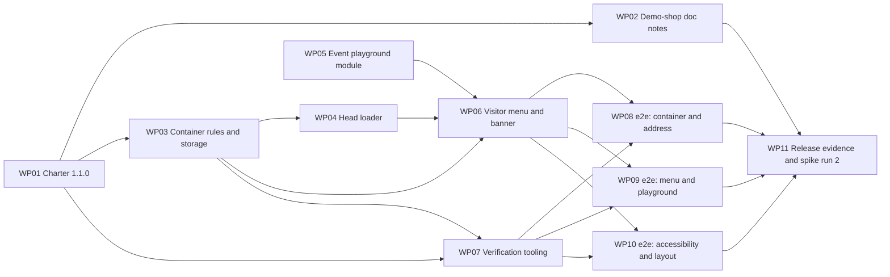

# Work Packages: Bring your own GTM container

**Inputs**: Design documents from `kitty-specs/byo-gtm-container-01M64PAZ/`
**Prerequisites**: plan.md (required), spec.md (user stories), research.md, data-model.md, contracts/, quickstart.md

**Tests**: The spec and plan explicitly require non-gate checks (`pnpm verify:container`, `pnpm test:e2e` with Playwright and axe) to prove NFR-001 to NFR-003 and SC-001 to SC-006. They are planned here as their own work packages. The four gates (lint, build, no-secrets, provenance) are unchanged.

**Organization**: Subtasks (`Txxx`) roll up into work packages (`WPxx`). Each WP is independently deliverable and reviewable. Completion is recorded with `spec-kitty agent tasks mark-status Txxx --status done`, never by editing this file.

**Prompt files**: Each WP links to a prompt in the flat `tasks/` directory.

**Secrets rule for every WP (FR-019, QDR-004)**: the only container-ID-shaped literal allowed in any tracked file is `GTM-XXXXXXX`. Tests and checks build every other ID while they run, for example `['GTM', 'SHOPE2E'].join('-')`.

## Dependency graph

## Subtask Index (reference only)

| ID | Description | WP | Parallel |
|----|-------------|----|----------|
| T001 | Amend QDR-002 (one container per page) in charter.md and charter.yaml | WP01 | |
| T002 | Add "Dev tooling (not shipped)" row and reword QDR-004 to the shop's own container | WP01 | |
| T003 | Enforcement table, checklist wording and mechanism statement | WP01 | |
| T004 | Version, date, amendment log row, consistency check | WP01 | |
| T005 | Annotate demo-shop FR-003, NFR-004, C-011 as scoped by Charter 1.1.0 | WP02 | [P] |
| T006 | Add the Event playground note to the demo-shop push contract (FR-026) | WP02 | [P] |
| T007 | Secrets and terminology check of the edited docs | WP02 | |
| T008 | `active-container.ts`: constants and `isContainerId` | WP03 | |
| T009 | `active-container.ts`: `parseSavedContainer` and `serialiseSavedContainer` | WP03 | |
| T010 | `active-container.ts`: `chooseContainer` | WP03 | |
| T011 | `visitor-storage.ts`: guarded `probe`, `save`, `clear` | WP03 | [P] |
| T012 | ESLint: forbid `location` and friends in `site/src/container/**`; ignore e2e output folders | WP03 | [P] |
| T013 | Read and type-strip `active-container.ts` at build time | WP04 | |
| T014 | Self-contained guards on the inlined code | WP04 | |
| T015 | Emit the inline loader in place of `<!-- gtm:head -->` | WP04 | |
| T016 | Keep `<!-- gtm:body -->` shop-only; update warnings and comments | WP04 | |
| T017 | Manual build check across shop, none and visitor states | WP04 | |
| T018 | Playground button model (hero line, 7 entries from `SCENARIOS`) | WP05 | |
| T019 | `mountPlayground`: render buttons and press handlers | WP05 | |
| T020 | Announce each press; no side effects; double-mount guard | WP05 | |
| T021 | Manual data layer check of all 7 buttons | WP05 | |
| T022 | `banner.ts`: banner with the visitor's ID and reset | WP06 | [P] |
| T023 | `visitor-menu.ts`: toggle, panel and disclosure accessibility | WP06 | |
| T024 | Path 1 behaviour | WP06 | |
| T025 | Path 2 form, refusal message and save | WP06 | |
| T026 | Storage-unavailable note and path 2 instructions copy | WP06 | |
| T027 | Mount banner and menu from `layout.ts`, once per page | WP06 | |
| T028 | Styles: toggle, panel, banner, 360 px rules | WP06 | |
| T029 | Extract `scanText` into `scripts/lib/secret-scan.ts` | WP07 | [P] |
| T030 | `scripts/verify-container.ts` and `pnpm verify:container` | WP07 | |
| T031 | Add Playwright and axe dev dependencies; supply-chain record | WP07 | |
| T032 | `playwright.config.ts` and `e2e/fixtures.ts` | WP07 | |
| T033 | `tsconfig.json`, `.gitignore`, `test:e2e` script | WP07 | |
| T034 | `AGENTS.md`: dev deps, commands, browser install | WP07 | |
| T035 | `e2e/container.spec.ts`: one request per load, both states, 5 pages | WP08 | |
| T036 | Expired, tampered, future-dated and throwing storage cases | WP08 | |
| T037 | Reset restores the shop's container on the next load | WP08 | |
| T038 | `e2e/address.spec.ts`: crafted links never change the container | WP08 | [P] |
| T039 | `e2e/menu.spec.ts`: save, reload, banner on every page | WP09 | |
| T040 | Malformed IDs (≥10) refused, nothing saved | WP09 | |
| T041 | Path 1 and reset; menu actions push nothing | WP09 | |
| T042 | `e2e/playground.spec.ts`: 7 shapes, one push each; scenario links | WP09 | [P] |
| T043 | `e2e/a11y.spec.ts`: axe matrix (5 pages × menu × banner) | WP10 | |
| T044 | Keyboard flows: open, Escape, focus return, Tab reach | WP10 | |
| T045 | `e2e/layout.spec.ts`: 0 px overflow at 360 px | WP10 | [P] |
| T046 | Full `pnpm test:e2e` run, flake check and evidence | WP10 | |
| T047 | Gates and checks on the merged tree; record in `docs/release-checks.md` | WP11 | |
| T048 | Lighthouse mobile LCP on the Pages preview (NFR-004) | WP11 | |
| T049 | Spike run 2 with the Product Owner; record in `docs/spike/preview-spike.md` | WP11 | |
| T050 | Settle path 2 copy from the spike result (FR-024) | WP11 | |
| T051 | Production rehearsal check, both paths (NFR-006, SC-007) | WP11 | |

---

## Phase 1 – Rulebook

### WP01 – Charter 1.1.0 amendment (Priority: P0)

**Goal**: Amend QDR-002 so the shop may load exactly one GTM container per page (its own or one the visitor types into the menu, never one from the address), approve Playwright and axe as dev-only tooling, and scope QDR-004's wording to the shop's own container.
**Independent Test**: `charter.md` and `charter.yaml` agree; version 1.1.0 with date; amendment log row present; Policy Summary headings unchanged; `pnpm gates` passes.
**Prompt**: `tasks/WP01-charter-amendment.md`
**Estimated prompt size**: ~260 lines

**Included subtasks**:
T001 Amend QDR-002 (one container per page) in charter.md and charter.yaml (WP01)
T002 Add "Dev tooling (not shipped)" row and reword QDR-004 to the shop's own container (WP01)
T003 Enforcement table, checklist wording and mechanism statement (WP01)
T004 Version, date, amendment log row, consistency check (WP01)

**Implementation sketch**: Edit both charter files in one pass, following research R-09 word for word where it gives text. Keep the Policy Summary, Terminology Canon, Code Review Checklist and Regression Vigilance headings exactly as they are.

**Parallel opportunities**: None inside the WP; it is short and sequential.
**Dependencies**: None. Goes first; WP02, WP03 and WP07 depend on it.
**Risks**: `charter.md` and `charter.yaml` drifting; renaming a heading Spec Kitty reads; the commit message must give the reasoning (QDR-007).

---

### WP02 – Demo-shop documentation notes (Priority: P1)

**Goal**: Record in the earlier mission's documents what Charter 1.1.0 scopes (FR-003, NFR-004, C-011) and add the Event playground note to the push contract (FR-026).
**Independent Test**: Three demo-shop spec rows carry "Scoped by Charter 1.1.0"; the push contract's "Sequence per action" section carries the playground note verbatim; no other text in those files changes.
**Prompt**: `tasks/WP02-demo-shop-doc-notes.md`
**Estimated prompt size**: ~170 lines

**Included subtasks**:
T005 Annotate demo-shop FR-003, NFR-004, C-011 as scoped by Charter 1.1.0 (WP02)
T006 Add the Event playground note to the demo-shop push contract (FR-026) (WP02)
T007 Secrets and terminology check of the edited docs (WP02)

**Implementation sketch**: Append inline annotations to three table rows; insert the note from `contracts/playground-pushes.md` under "Sequence per action".
**Parallel opportunities**: T005 and T006 touch different files.
**Dependencies**: WP01.
**Risks**: Editing row text beyond the annotation; breaking Markdown table pipes.

---

## Phase 2 – Foundation: choosing the container

### WP03 – Container choice rules and storage (Priority: P0)

**Goal**: One self-contained file holds the choice rules (ID pattern, 24-hour expiry, tamper handling, pure `chooseContainer`); one module wraps `localStorage` so it never throws; lint forbids reading the address in that folder.
**Independent Test**: `pnpm lint` and `pnpm build` pass; a scratch `node` run of the pure functions gives the documented answers (formal checks land in WP07's `verify:container`).
**Prompt**: `tasks/WP03-container-rules-and-storage.md`
**Estimated prompt size**: ~380 lines

**Included subtasks**:
T008 `active-container.ts`: constants and `isContainerId` (WP03)
T009 `active-container.ts`: `parseSavedContainer` and `serialiseSavedContainer` (WP03)
T010 `active-container.ts`: `chooseContainer` (WP03)
T011 `visitor-storage.ts`: guarded `probe`, `save`, `clear` (WP03)
T012 ESLint: forbid `location` and friends in `site/src/container/**`; ignore e2e output folders (WP03)

**Implementation sketch**: Write `active-container.ts` with no imports and only top-level `export const`/`export function`/`export type`. Then `visitor-storage.ts`, importing from it. Then the lint override.
**Parallel opportunities**: T011 and T012 once T008 to T010 settle the public surface.
**Dependencies**: WP01.
**Risks**: Any import or outside reference in `active-container.ts` breaks inlining (WP04); `localStorage` property access itself can throw.

---

### WP04 – Inline head loader (Priority: P0)

**Goal**: The `quadrano-gtm` Vite plugin inlines the choice rules into `<head>` so each page requests exactly one container before any page module runs; the no-script fallback stays shop-only.
**Independent Test**: Built pages contain one inline loader in place of `<!-- gtm:head -->`; in a browser, the shop's ID loads with nothing saved, the visitor's ID loads with a valid saved value, and the `<html>` attributes match `contracts/container-choice.md`.
**Prompt**: `tasks/WP04-inline-head-loader.md`
**Estimated prompt size**: ~360 lines

**Included subtasks**:
T013 Read and type-strip `active-container.ts` at build time (WP04)
T014 Self-contained guards on the inlined code (WP04)
T015 Emit the inline loader in place of `<!-- gtm:head -->` (WP04)
T016 Keep `<!-- gtm:body -->` shop-only; update warnings and comments (WP04)
T017 Manual build check across shop, none and visitor states (WP04)

**Implementation sketch**: In `vite.config.ts`, strip types with `transformWithOxc`, drop `export` keywords, guard, wrap in an IIFE with the loader glue and the standard GTM snippet.
**Parallel opportunities**: None; one file.
**Dependencies**: WP03.
**Risks**: Two `gtm.js` requests; reading the address; `</script>` inside the inlined code; the dev server path (`pnpm dev`) must still work.

---

## Phase 3 – User stories (menu, banner, playground)

### WP05 – Event playground module (Priority: P1) 🎯 parallel with Phase 2

**Goal**: `site/src/menu/playground.ts` renders 7 buttons; each press makes exactly one existing push through `push.ts` (FR-014 to FR-016).
**Independent Test**: Mounted into a scratch container on any page, each button adds exactly `[{ ecommerce: null }, <event>]` to `window.dataLayer`, and nothing else changes.
**Prompt**: `tasks/WP05-event-playground.md`
**Estimated prompt size**: ~280 lines

**Included subtasks**:
T018 Playground button model (hero line, 7 entries from `SCENARIOS`) (WP05)
T019 `mountPlayground`: render buttons and press handlers (WP05)
T020 Announce each press; no side effects; double-mount guard (WP05)
T021 Manual data layer check of all 7 buttons (WP05)

**Implementation sketch**: Build the 7 entries from `SCENARIOS` plus `add_to_cart`; render native buttons; inject `announce` to avoid an import cycle with `layout.ts`.
**Parallel opportunities**: Whole WP runs in parallel with WP01 to WP04.
**Dependencies**: None.
**Risks**: Duplicate listeners pushing twice; accidentally touching the address, switcher or order store.

---

### WP06 – Visitor menu, banner and layout (Priority: P1) 🎯 MVP completion

**Goal**: Every page shows a floating "Demo menu" button opening an accessible disclosure panel with path 1, path 2 and the playground; while a visitor's container is active, a banner names it and offers reset.
**Independent Test**: On all 5 pages: open, close and Escape work by keyboard; a well-formed ID saves and reloads into the visitor state with the banner; a malformed ID is refused; reset and path 1 restore the shop's container; layout holds at 360 px.
**Prompt**: `tasks/WP06-visitor-menu-and-banner.md`
**Estimated prompt size**: ~480 lines

**Included subtasks**:
T022 `banner.ts`: banner with the visitor's ID and reset (WP06)
T023 `visitor-menu.ts`: toggle, panel and disclosure accessibility (WP06)
T024 Path 1 behaviour (WP06)
T025 Path 2 form, refusal message and save (WP06)
T026 Storage-unavailable note and path 2 instructions copy (WP06)
T027 Mount banner and menu from `layout.ts`, once per page (WP06)
T028 Styles: toggle, panel, banner, 360 px rules (WP06)

**Implementation sketch**: Banner first (smallest), then menu shell and focus handling, then each path, then copy, then mount in layout, then CSS.
**Parallel opportunities**: T022 alongside T023; T028 once the DOM structure is fixed.
**Dependencies**: WP03, WP04, WP05.
**Risks**: Verdict wording in copy (lint); `display` overriding `[hidden]`; focus not returning; the fixed toggle covering content at 360 px.

---

## Phase 4 – Verification

### WP07 – Verification tooling (Priority: P1)

**Goal**: Keep the no-secrets gate exactly as strict while making it importable; add `pnpm verify:container`; add Playwright and axe (dev only) with a config that builds with run-time IDs and stubs googletagmanager.com.
**Independent Test**: `pnpm gates` passes with identical no-secrets output; `pnpm verify:container` passes and proves the scanner still flags a real-looking ID; `pnpm test:e2e` runs a smoke spec green with zero external requests.
**Prompt**: `tasks/WP07-verification-tooling.md`
**Estimated prompt size**: ~470 lines

**Included subtasks**:
T029 Extract `scanText` into `scripts/lib/secret-scan.ts` (WP07)
T030 `scripts/verify-container.ts` and `pnpm verify:container` (WP07)
T031 Add Playwright and axe dev dependencies; supply-chain record (WP07)
T032 `playwright.config.ts` and `e2e/fixtures.ts` (WP07)
T033 `tsconfig.json`, `.gitignore`, `test:e2e` script (WP07)
T034 `AGENTS.md`: dev deps, commands, browser install (WP07)

**Implementation sketch**: Refactor the scanner with identical output first, then the pure-rules checker, then dependencies and config, then documentation.
**Parallel opportunities**: T029 alongside T031.
**Dependencies**: WP01 (dependencies approved), WP03 (rules to check).
**Risks**: A weakened gate; an ID-shaped literal in a test; lockfile surprises; browser download sneaking into `install`.

---

### WP08 – e2e: one container, and the address never chooses (Priority: P1)

**Goal**: Prove NFR-001, SC-001, SC-002 and SC-004 in Chromium with googletagmanager.com stubbed.
**Independent Test**: `pnpm test:e2e e2e/container.spec.ts e2e/address.spec.ts` passes, with the container spec repeated 10 times.
**Prompt**: `tasks/WP08-e2e-container-and-address.md`
**Estimated prompt size**: ~330 lines

**Included subtasks**:
T035 `e2e/container.spec.ts`: one request per load, both states, 5 pages (WP08)
T036 Expired, tampered, future-dated and throwing storage cases (WP08)
T037 Reset restores the shop's container on the next load (WP08)
T038 `e2e/address.spec.ts`: crafted links never change the container (WP08)

**Parallel opportunities**: T038 alongside T035 to T037.
**Dependencies**: WP06, WP07.
**Risks**: Counting requests from the wrong page load; a hard-coded ID literal.

---

### WP09 – e2e: menu and playground (Priority: P1)

**Goal**: Prove FR-005 to FR-010, FR-015, FR-017, SC-003, SC-005 and SC-006 end to end.
**Independent Test**: `pnpm test:e2e e2e/menu.spec.ts e2e/playground.spec.ts` passes.
**Prompt**: `tasks/WP09-e2e-menu-and-playground.md`
**Estimated prompt size**: ~360 lines

**Included subtasks**:
T039 `e2e/menu.spec.ts`: save, reload, banner on every page (WP09)
T040 Malformed IDs (≥10) refused, nothing saved (WP09)
T041 Path 1 and reset; menu actions push nothing (WP09)
T042 `e2e/playground.spec.ts`: 7 shapes, one push each; scenario links (WP09)

**Parallel opportunities**: T042 alongside T039 to T041.
**Dependencies**: WP06, WP07.
**Risks**: Expected shapes copied from site code (tautological) instead of from the contract; thank-you page baseline pushes.

---

### WP10 – e2e: accessibility and phone layout (Priority: P2)

**Goal**: Prove NFR-002, NFR-003, FR-020 and FR-021; then run the full suite and record evidence.
**Independent Test**: `pnpm test:e2e` passes in full, 3 consecutive runs.
**Prompt**: `tasks/WP10-e2e-a11y-and-layout.md`
**Estimated prompt size**: ~320 lines

**Included subtasks**:
T043 `e2e/a11y.spec.ts`: axe matrix (5 pages × menu × banner) (WP10)
T044 Keyboard flows: open, Escape, focus return, Tab reach (WP10)
T045 `e2e/layout.spec.ts`: 0 px overflow at 360 px (WP10)
T046 Full `pnpm test:e2e` run, flake check and evidence (WP10)

**Parallel opportunities**: T045 alongside T043 and T044.
**Dependencies**: WP06, WP07.
**Risks**: Fixing an axe finding outside this WP's files; disabling axe rules to get green.

---

## Phase 5 – Release evidence

### WP11 – Release evidence and Preview spike run 2 (Priority: P1)

**Goal**: Record gate, e2e, Lighthouse and rehearsal evidence; run spike run 2 with the Product Owner; settle the path 2 copy (FR-023, FR-024, NFR-004, NFR-006, SC-007, SC-008).
**Independent Test**: `docs/release-checks.md` and `docs/spike/preview-spike.md` hold dated, redacted evidence for every manual check in `quickstart.md`, and the path 2 copy matches the spike result.
**Prompt**: `tasks/WP11-release-evidence-and-spike.md`
**Estimated prompt size**: ~300 lines

**Included subtasks**:
T047 Gates and checks on the merged tree; record in `docs/release-checks.md` (WP11)
T048 Lighthouse mobile LCP on the Pages preview (NFR-004) (WP11)
T049 Spike run 2 with the Product Owner; record in `docs/spike/preview-spike.md` (WP11)
T050 Settle path 2 copy from the spike result (FR-024) (WP11)
T051 Production rehearsal check, both paths (NFR-006, SC-007) (WP11)

**Dependencies**: WP02, WP08, WP09, WP10.
**Risks**: Product Owner availability before Thu 19 Nov 2026 (C-006); unredacted IDs in screenshots; fabricating evidence that wasn't gathered.

---

## Dependency & Execution Summary

- **Sequence**: WP01 → (WP02, WP03) → WP04 → WP06 → (WP08, WP09, WP10) → WP11. WP05 runs from the start in parallel; WP07 starts as soon as WP03 lands.
- **Parallelization**: three early tracks (WP01→WP03→WP04, WP05, then WP07 and WP02); three e2e WPs in parallel after WP06 and WP07.
- **MVP scope**: WP01, WP03, WP04, WP05, WP06 give a working shop with both paths and the playground. WP07 to WP10 prove it; WP11 releases it.

---

## Requirements Coverage Summary

| Requirement ID | Covered By Work Package(s) |
|----------------|----------------------------|
| FR-001 | WP04, WP08 |
| FR-002 | WP04 |
| FR-003 | WP01, WP04 |
| FR-004 | WP04 |
| FR-005 | WP06, WP09 |
| FR-006 | WP03, WP06, WP09 |
| FR-007 | WP06, WP09 |
| FR-008 | WP06, WP09 |
| FR-009 | WP06, WP09 |
| FR-010 | WP06, WP09 |
| FR-011 | WP03, WP08 |
| FR-012 | WP03, WP04, WP06, WP08 |
| FR-013 | WP03, WP08 |
| FR-014 | WP05 |
| FR-015 | WP05, WP09 |
| FR-016 | WP05 |
| FR-017 | WP06, WP09 |
| FR-018 | WP05, WP09 |
| FR-019 | WP07 |
| FR-020 | WP06, WP10 |
| FR-021 | WP06, WP10 |
| FR-022 | WP06 |
| FR-023 | WP11 |
| FR-024 | WP06, WP11 |
| FR-025 | WP01, WP02 |
| FR-026 | WP02 |
| NFR-001 | WP08 |
| NFR-002 | WP10 |
| NFR-003 | WP10 |
| NFR-004 | WP11 |
| NFR-005 | WP05, WP09 |
| NFR-006 | WP11 |

---

## Subtask Index (Reference)

| Subtask ID | Summary | Work Package | Priority | Parallel? |
|------------|---------|--------------|----------|-----------|
| T001–T004 | Charter 1.1.0 | WP01 | P0 | No |
| T005–T007 | Demo-shop doc notes | WP02 | P1 | T005/T006 |
| T008–T012 | Container rules and storage | WP03 | P0 | T011/T012 |
| T013–T017 | Inline head loader | WP04 | P0 | No |
| T018–T021 | Event playground | WP05 | P1 | Whole WP |
| T022–T028 | Visitor menu and banner | WP06 | P1 | T022, T028 |
| T029–T034 | Verification tooling | WP07 | P1 | T029/T031 |
| T035–T038 | e2e container and address | WP08 | P1 | T038 |
| T039–T042 | e2e menu and playground | WP09 | P1 | T042 |
| T043–T046 | e2e a11y and layout | WP10 | P2 | T045 |
| T047–T051 | Release evidence and spike | WP11 | P1 | No |
