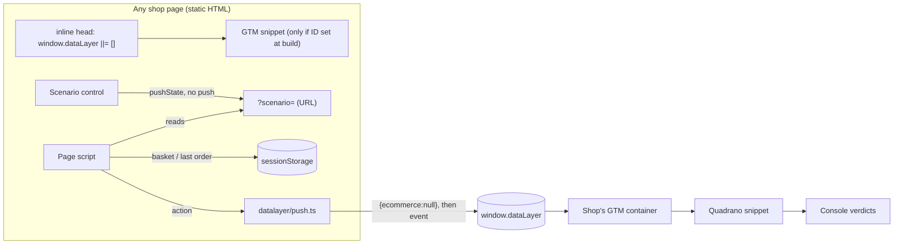

# Implementation Plan: Demo Shop

**Branch**: `feat/demo-shop` (planning base and merge target; reaches `main` by pull request) | **Date**: 2026-10-24 | **Spec**: [spec.md](spec.md)
**Input**: Mission specification from `kitty-specs/demo-shop-01M5QW5Y/spec.md`
**Plan decisions**: `DM-01M5QXTJSS08GV3TDMWA59QCGY` (GTM ID injection), `DM-01M5QXTNC6EKYRJP56QZ5JXSCJ` (deploy pipeline), `DM-01M5QXTQXTG6ASW9E96GQM6ARX` (supporting dev dependencies).

## Summary

A five-page static shop built with Vite multi-page mode and TypeScript, deployed by Cloudflare Pages' Git integration to `demo.quadrano.com`. Every page creates `window.dataLayer` in an inline head script, then loads the shop's GTM container. The container ID is written into the HTML at build time from a Cloudflare Pages build variable and never exists in the repository. Shop actions call one push module. It builds `add_to_cart` and `purchase` objects, and each scenario changes the correct `purchase` in exactly one way. The active scenario lives in the URL (`?scenario=`). An on-page control changes it with `history.pushState` and makes no push. The four gates (lint, build, no-secrets, provenance) are small TypeScript scripts. Node 24 runs them directly through its native type stripping, so no extra runners are needed. `pnpm gates` runs them, and so do a `core.hooksPath` pre-push hook and a GitHub Actions workflow.

The main design choice is that **`purchase` is pushed when the thank-you page loads, not on the checkout click**. Checkout records the order and navigates. The thank-you page pushes once and marks the order as pushed. This keeps the verdict in a Console that is not cleared by navigation. It also matches GA4 practice and makes a reload safe (see research R-03).



## Technical Context

**Language/Version**: TypeScript (current stable 5.x, `erasableSyntaxOnly`) on Node.js 24 LTS, pinned by `.node-version` and `engines`.
**Primary Dependencies**: Dev only: `vite`, `typescript`, `eslint`, `@eslint/js` and `typescript-eslint`. There are no runtime dependencies, and the shipped JS is our own code plus Google's GTM snippet. Package manager: pnpm 10, pinned by `packageManager`.
**Storage**: `sessionStorage` in the browser for the basket and the last order. Every access is wrapped in try/catch and falls back to memory. There is no server storage (C-001).
**Testing**: The four gates are lint, build (`tsc --noEmit` + `vite build`), no-secrets and provenance. A non-gate script, `pnpm verify:scenarios`, checks FR-012 (exactly one difference per broken scenario) with plain `node:assert`. The rest is a manual pre-rehearsal checklist in [quickstart.md](quickstart.md), run 10 times for NFR-003. No test framework is added (QDR-003: nothing heavier).
**Target Platform**: Current desktop Chrome, which the presenter uses with DevTools Console and Tag Assistant. Modern evergreen browsers also need to work. Pages are served by Cloudflare Pages, with a local fallback through `vite preview`.
**Project Type**: Single static web project. Vite `root` is `site/`, and gate scripts live in `scripts/`.
**Performance Goals**: Each page's LCP is ≤ 2 s in Lighthouse mobile with default (Slow 4G) throttling (NFR-001). This means no web fonts, no raster images (only inline SVG/CSS art) and one small JS bundle per page.
**Constraints**: No backend, no Pages Functions and no secrets in the repo. The only network requests go to our own origin and GTM (NFR-004). The shop makes no Console output (FR-017, enforced by lint). Everything is keyboard operable (NFR-005). Demoable by Sun 8 Nov 2026.
**Scale/Scope**: 5 pages, about 4 fictional products, 2 events, 6 scenarios (1 correct and 5 broken), 4 gates and 1 presenter.

## Charter Check

*GATE: Must pass before Phase 0 research. Re-checked after Phase 1 design (below).*

| Rule | Status | How the plan satisfies it |
|---|---|---|
| QDR-001 Provenance | ✅ | All code is original. The GTM snippet is Google's publicly documented install code, used as Google intends. The product art is original SVG. The provenance gate enforces the denylist rules (IC-02). |
| QDR-002 Approved stack | ✅ | It is a static site on Cloudflare Pages with its own GTM container. No Pages Functions are used (DM `…QCGY`). The supporting dev dependencies are confirmed as within C-009 (DM `…6ARX`). |
| QDR-003 Minimal gates | ✅ | `pnpm gates` runs lint → build → no-secrets → provenance and stops at the first failure. Pre-push hook and CI. No extra gates; `verify:scenarios` is a developer check, not a gate. |
| QDR-004 No secrets | ✅ | `VITE_GTM_CONTAINER_ID` exists only in Cloudflare Pages build variables. `dist/` is gitignored. The no-secrets gate scans tracked files, pushed file versions and full history (SC-006). |
| QDR-005 Contract only | ✅ | The shop only pushes objects. It never imports Quadrano code, and the Console text comes from the runtime. Attribute names are reconciled at the W2 freeze (FR-024, IC-06). |
| QDR-006 Escalation | ✅ | Open risk: nested Event Definitions on stage (spec Assumptions). This is the Product Owner's call at the freeze, not the implementer's. |
| QDR-007 Amendments | ✅ | None needed for this mission. The wording drift found here (the Charter said "logs ✅/❌" where Console format v1 uses ✓/✗) was fixed by Charter patch amendment 1.0.1 (2026-10-24). |
| Terminology Canon | ✅ | Code uses `scenario` (a local term, not a domain term) and "Attribute" in docs and comments. The words "schema", "spec", "tracking plan" and "parameter" are not used for domain concepts. |

**Post-design re-check (after Phase 1):** No new violations. One trade-off was checked: the decision to push `purchase` on thank-you load (R-03) still gives one event push per place-order action (FR-016), because the order record is marked `pushed`.

## Project Structure

### Documentation (this mission)

```
kitty-specs/demo-shop-01M5QW5Y/
├── spec.md
├── plan.md              # this file
├── research.md          # Phase 0: decisions R-01…R-12, supply-chain and adversarial pass
├── data-model.md        # Phase 1: Product, Basket, Order, Scenario, Event push
├── quickstart.md        # Phase 1: run, gate, deploy, rehearse
├── contracts/
│   ├── datalayer-pushes.md     # exact push objects per scenario + expected Console group
│   ├── scenario-url.md         # link format and switcher behaviour
│   └── gates-cli.md            # gate runner, hook, CI, denylist contract
└── tasks.md             # created by /spec-kitty.tasks (not by this command)
```

### Source Code (repository root)

```
site/                         # Vite root (multi-page)
├── index.html                # product listing
├── product/index.html        # product page (?id=<item_id>)
├── basket/index.html
├── checkout/index.html
├── thank-you/index.html
└── src/
    ├── pages/                # one entry per page: listing.ts, product.ts, basket.ts, checkout.ts, thank-you.ts
    ├── shop/                 # catalogue.ts, basket-store.ts, order-store.ts, storage.ts (safe sessionStorage)
    ├── datalayer/            # push.ts (only module touching window.dataLayer), events.ts, scenarios.ts
    ├── switcher/             # scenario-url.ts (parse/format), switcher.ts (control + popstate)
    └── ui/                   # layout.ts (header, nav carrying ?scenario=), styles.css, art.ts (inline SVG)
public/                       # static assets copied as-is (favicon.svg)
scripts/
├── gates.ts                  # runner: lint → build → no-secrets → provenance
├── no-secrets.ts
├── provenance.ts
├── verify-scenarios.ts       # FR-012 check (not a gate)
└── lib/                      # git.ts (ls-files, push ranges, history), report.ts
.githooks/pre-push            # calls `pnpm gates --pre-push` with git's stdin
.github/workflows/gates.yml   # pnpm gates on push + pull_request
vite.config.ts                # MPA inputs + GTM injection plugin
eslint.config.js
tsconfig.json
package.json                  # scripts: lint, build, gates, preview, verify:scenarios, prepare
pnpm-workspace.yaml           # supply-chain settings (minimumReleaseAge, onlyBuiltDependencies)
.node-version
AGENTS.md                     # tooling + exact gate commands (FR-023)
```

**Structure decision**: Single static project with `site/` as the Vite root, so HTML, the README and repo tooling stay apart. `datalayer/push.ts` is the only module that touches `window.dataLayer`, and lint enforces this (R-08). That keeps "one event push per action" and "no verdicts" checkable in one place.

## Complexity Tracking

No Charter violations; nothing to justify.

## Implementation Concern Map

> Implementation concerns are not work packages. `/spec-kitty.tasks` turns them into WPs.

### IC-01 — Repository foundation and tooling

- **Purpose**: Set up the fixed toolchain (pnpm, Vite multi-page, TypeScript, ESLint) with supply-chain settings, and record it in `AGENTS.md`.
- **Relevant requirements**: FR-023, C-009. Supports FR-017 (lint rules) and NFR-004.
- **Affected surfaces**: `package.json`, `pnpm-workspace.yaml`, `pnpm-lock.yaml`, `.node-version`, `tsconfig.json`, `eslint.config.js`, `vite.config.ts` (inputs only), `.gitignore`, `AGENTS.md`.
- **Sequencing/depends-on**: none.
- **Risks**: Pick dependency versions at install time, at least 7 days old (`minimumReleaseAge`). Deny lifecycle scripts by default. Node type stripping needs erasable-only TS syntax and `.ts` import extensions in `scripts/`.

### IC-02 — Quality gates (runner, no-secrets, provenance, hook, CI)

- **Purpose**: Enforce QDR-001/003/004 with one command, which also runs before every push and in CI.
- **Relevant requirements**: FR-018, FR-019, FR-020; SC-005, SC-006.
- **Affected surfaces**: `scripts/*`, `.githooks/pre-push`, `.github/workflows/gates.yml`, `package.json` scripts.
- **Sequencing/depends-on**: IC-01.
- **Risks**: The provenance output must never echo a term or the matched line. The scanners must not flag their own regex source. A placeholder like `GTM-XXXXXXX` is allowlisted exactly. CI needs `fetch-depth: 0` for the push range and history scan. The denylist is a GitHub Actions secret and the job fails if it is empty. Prove each gate can fail (Charter: "a check that can never fail is removed").

### IC-03 — Shop pages, basket and GTM install

- **Purpose**: Build five thin, plausible pages for a fictional brand. Each creates the data layer first, then loads GTM when an ID was supplied at build.
- **Relevant requirements**: FR-001, FR-002, FR-003; NFR-001, NFR-004, NFR-005; C-010, C-011; edge cases (GTM blocked, missing ID, empty basket).
- **Affected surfaces**: `site/*.html`, `site/src/pages/*`, `site/src/shop/*`, `site/src/ui/*`, `vite.config.ts` (GTM plugin).
- **Sequencing/depends-on**: IC-01.
- **Risks**: Validate the GTM ID format at build, and if it is missing or invalid, emit no GTM tag and print a build warning, never a fallback ID. Storage can throw (private mode), so fall back to memory.

### IC-04 — Data layer pushes and scenarios

- **Purpose**: Build correct `add_to_cart`/`purchase` objects and the five deliberately broken `purchase` variants. Each action pushes once, after `{ecommerce: null}`.
- **Relevant requirements**: FR-004 to FR-012, FR-016, FR-017; US1, US2.
- **Affected surfaces**: `site/src/datalayer/*`, `site/src/shop/order-store.ts`, `site/src/pages/product.ts`, `checkout.ts`, `thank-you.ts`, `scripts/verify-scenarios.ts`.
- **Sequencing/depends-on**: IC-03 (pages and basket), and can start in parallel on the pure builders.
- **Risks**: Scenario 2 must push the literal string `"12.99"`, so the talk's hero product costs £12.99 (R-05). The `purchase` push happens on thank-you load, guarded by `order.pushed` (R-03). [contracts/datalayer-pushes.md](contracts/datalayer-pushes.md) is the acceptance source.

### IC-05 — Scenario switcher

- **Purpose**: Let the presenter stage any scenario on any page in two interactions or fewer, through a link or an on-page control.
- **Relevant requirements**: FR-013, FR-014, FR-015; NFR-002, NFR-005; US3; back/forward edge case.
- **Affected surfaces**: `site/src/switcher/*`, `site/src/ui/layout.ts` (nav links carry `?scenario=`).
- **Sequencing/depends-on**: IC-04 (scenario registry), IC-03 (layout).
- **Risks**: Switching must never push. Unknown values fall back to `correct`, and the address is rewritten with `replaceState`. A native `<select>` gives keyboard access for free.

### IC-06 — Deploy, local fallback, freeze reconciliation and rehearsal

- **Purpose**: Put the shop live on `demo.quadrano.com`, keep an offline fallback, reconcile with the W2 freeze, and prove repeatability.
- **Relevant requirements**: FR-021, FR-022, FR-024; NFR-003; SC-001 to SC-005; C-008.
- **Affected surfaces**: Cloudflare Pages project settings (outside the repo), `quickstart.md` checklist, `AGENTS.md` deploy notes, any of `site/src/datalayer/*` if the freeze changes names or pattern.
- **Sequencing/depends-on**: IC-02 (green gates before the first production merge), IC-04, IC-05. FR-024 runs after Tue 27 Oct.
- **Risks**: Check that the Cloudflare build image honours `.node-version` and `packageManager` on the first deploy. The biggest schedule risk is nested Event Definitions not shipping in Quadrano Local by the freeze, which is the Product Owner's decision (spec Assumptions). Rehearse with DevTools "Preserve log" off to prove R-03.
