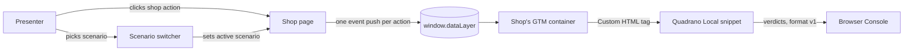

# Mission Specification: Demo Shop

**Mission Branch**: `feat/demo-shop`
**Created**: 2026-10-24
**Status**: Approved (Product Owner, 2026-10-24)
**Input**: Product Owner briefing `quadrano-demo-shop-briefing.md` (2026-10-24), read with build plan §1.1, §4.3 and the *Demo shop* mission entry, and the published-artefact contract v1.0 (frozen). Discovery decisions: `DM-01M5QW6HWHFC3AXGFN4T2PFNZP`, `DM-01M5QW8D947TS6KA1SRSTE5BC2`, `DM-01M5QWAQP6Q5KKQSQDFFNG0XYJ`.

## Purpose

The Quadrano talk (Thu 19 Nov 2026) needs a real website whose data layer Quadrano validates live on stage. This mission delivers a small static shop at `demo.quadrano.com`, with its own GTM container, whose actions push correct and deliberately broken `add_to_cart` and `purchase` events. A scenario switcher lets the presenter stage each case on cue. The audience sees Quadrano's own Console verdicts on genuine pushes.

The shop pushes data; it never judges it. Every verdict the audience sees is written by the Quadrano runtime, in Console output format v1, verbatim.

## User Scenarios & Testing *(mandatory)*

### User Story 1 - Correct pushes show ✓ (Priority: P1)

The presenter opens the shop with GTM installed, browses to a product, adds it to the basket and places an order. Each action pushes a correct, plausible GA4-shaped event. With the "Demo Shop" Specification's snippet installed in GTM, the Console shows `✓ add_to_cart` and `✓ purchase`.

**Why this priority**: Steps 1 and 7 of the talk script start here. Without plausible, correct pushes there is no demo, and no baseline for the broken ones.

**Independent Test**: Load the shop with the snippet installed, scenario "correct"; add to basket and place an order; confirm the two ✓ groups in the Console and the two events in GTM Preview.

**Acceptance Scenarios**:

1. **Given** the shop is loaded with GTM and the snippet installed and the scenario is "correct", **When** the presenter adds a product to the basket, **Then** the Console shows `✓ add_to_cart` and GTM Preview shows an `add_to_cart` event with currency, value and one item.
2. **Given** the same setup and a non-empty basket, **When** the presenter places the order, **Then** the Console shows `✓ purchase` and GTM Preview shows a `purchase` event with a transaction ID, value, currency GBP and the basket's items.
3. **Given** GTM is installed but the Quadrano snippet is not, **When** the presenter adds to the basket or places an order, **Then** the events still appear in GTM Preview and the Console shows no verdict of any kind.

---

### User Story 2 - Each broken push shows its ✗ message (Priority: P1)

The presenter picks a deliberately broken scenario and places an order. The Console shows ✗ with the exact Console format v1 sentence for that problem.

**Why this priority**: Step 7 of the talk script is the product's proof point.

**Independent Test**: For each broken scenario, select it, place an order, and compare the Console group with the expected-output table below, character for character.

**Acceptance Scenarios** (expected Console output, format v1, verbatim; group header first, then its lines; the `Pushed:` line is omitted):

| # | Scenario | Push difference from the correct `purchase` | Expected Console group |
|---|---|---|---|
| 1 | Missing value | `ecommerce.value` absent | `✗ purchase · 1 error` / `ecommerce.value is required, but is missing.` |
| 2 | Value as text | `ecommerce.value` is the string `"12.99"` | `✗ purchase · 1 error` / `ecommerce.value should be a number, but got "12.99".` |
| 3 | Wrong-case key | `ecommerce.transaction_ID` instead of `ecommerce.transaction_id` | `✗ purchase · 1 error, 1 warning` / `ecommerce.transaction_id is required, but is missing.` / `ecommerce.transaction_ID isn't in the Event Definition. Did you mean transaction_id?` |
| 4 | Lower-case currency | `ecommerce.currency` is `"gbp"` | `✗ purchase · 1 error` / `ecommerce.currency should be one of GBP, EUR, USD, but got "gbp".` |
| 5 | Bad transaction ID *(spare, not in the talk script)* | `ecommerce.transaction_id` does not match the agreed pattern | `✗ purchase · 1 error` / `ecommerce.transaction_id should match the pattern {pattern}, but got "{value}".` with the agreed pattern and the pushed value filled in |

1. **Given** the snippet is installed and a broken scenario is selected, **When** the presenter places an order, **Then** the Console shows exactly the group in that scenario's row.
2. **Given** a broken scenario is selected, **When** the presenter adds to the basket, **Then** the `add_to_cart` push is correct and shows `✓ add_to_cart` (broken scenarios affect `purchase` only).
3. **Given** any broken scenario, **When** the push is made, **Then** the event still reaches GTM Preview (Quadrano never blocks or changes a push).

---

### User Story 3 - Walk the talk script with the scenario switcher (Priority: P1)

The presenter moves through the talk script quickly: each scenario, and any page, is reachable from a link or from an on-page control, so a bug can be staged on cue without navigating the shop by hand.

**Why this priority**: The talk has a fixed time slot; the switcher is what makes the demo repeatable in three clean rehearsals.

**Independent Test**: From a cold start, reach each scenario on the checkout page in at most two interactions, using a bookmarked link and, separately, the on-page control.

**Acceptance Scenarios**:

1. **Given** a link that names a scenario and a page, **When** the presenter opens it, **Then** that page loads with that scenario active and the control shows it.
2. **Given** any page, **When** the presenter picks a scenario from the on-page control, **Then** the address updates to name that scenario, no data layer push is made, and the next order uses it.
3. **Given** a link with no scenario, or an unrecognised one, **When** it loads, **Then** the scenario is "correct" and the control shows "correct".
4. **Given** the control is open, **When** the presenter reads it, **Then** scenarios appear in talk-script order: correct, then broken scenarios 1–4, then the spare.

---

### User Story 4 - Live, gated and safe to rehearse (Priority: P2)

The shop is served from `demo.quadrano.com`, every push to the repository passes the minimal gates, and a local build can stand in if the venue network fails.

**Why this priority**: Required by the Charter and by "on production infrastructure", but it delivers no demo value on its own.

**Independent Test**: Run the gate runner locally and confirm all four gates run in order; open `demo.quadrano.com`; serve a local build with no network and confirm the pages and pushes work.

**Acceptance Scenarios**:

1. **Given** a clean checkout, **When** the gate runner runs, **Then** lint, build, no-secrets and provenance run in that order and the run stops at the first failure.
2. **Given** a change that adds a GTM container ID or a secret-like value, **When** the gate runner runs, **Then** the no-secrets gate fails and the push is refused.
3. **Given** the provenance denylist is missing, empty or unreadable, **When** the provenance gate runs, **Then** it fails, and its output never repeats a matched term.
4. **Given** the production deploy, **When** `demo.quadrano.com` is opened, **Then** the shop loads with the GTM container whose ID comes from the hosting environment.
5. **Given** no network, **When** a local build is served, **Then** every page and scenario works and pushes to the data layer (GTM and Quadrano will not load without network unless served locally as well).

---

### Edge Cases

- **GTM fails to load** (blocked, offline, no container ID set): the shop still works and pushes to `window.dataLayer`; nothing in the shop errors.
- **Container ID missing at build or deploy**: the build still completes, the page loads without GTM, and the omission is visible to the presenter in GTM Preview (no container connects). It never falls back to an ID stored in the repo.
- **Snippet loads after early pushes**: the data layer exists before GTM loads, so Quadrano replays earlier pushes in order (contract G-10).
- **Ecommerce clear push** (`{ecommerce: null}`): Quadrano writes nothing for a push with no `event` (contract §5.8), so it never adds noise.
- **Repeated clicks**: each click is one action and one event push (preceded by the FR-006 ecommerce clear); there is no double event push from one click.
- **Empty basket at checkout**: placing an order is not possible; no `purchase` is pushed.
- **Browser back/forward between scenarios**: the active scenario follows the address shown.
- **Second Specification loaded** (e.g. two tags in the container): Quadrano writes its two-Specifications warning; the shop does nothing about it. It is a container set-up error.

## Domain Language

The Charter's Terminology Canon applies exactly: **Event Definition**, **Attribute**, **Data Layer Specification** ("Specification"), **Event Catalogue**, **Event Library**, **Version**. Use "Attribute", never "parameter", "property" or "field".

Terms local to this repo, which are not domain terms:

| Term | Meaning |
|---|---|
| Scenario | One named way the shop builds its `purchase` push: "correct", or one deliberately broken variant |
| Correct push / deliberately broken push | A testing mode of the shop. "Broken" is not a domain term |
| Scenario switcher | The link format and on-page control that select the active scenario |
| Verdict | What the Quadrano runtime writes to the Console for a push (✓, ⚠, ✗). The shop never produces one |

## Requirements *(mandatory)*

### Functional Requirements

| ID | Title | User Story | Priority | Status |
|----|-------|------------|----------|--------|
| FR-001 | Shop pages | As the presenter, I want five thin static pages (product listing, product page, basket, checkout, thank-you) selling fictional products, so that the shop looks real in GTM Preview. | High | Open |
| FR-002 | Data layer first | As the presenter, I want every page to create `window.dataLayer` before GTM loads, so that Quadrano finds the data layer and replays early pushes. | High | Open |
| FR-003 | GTM on every page | As the presenter, I want every page to load the shop's own GTM container, with its ID supplied by the hosting environment and never stored in the repository, so that the snippet runs on every page. | High | Open |
| FR-004 | Correct add_to_cart | As the presenter, I want adding a product to the basket to push one `add_to_cart` with `ecommerce.currency` (GBP), `ecommerce.value` (a number) and `ecommerce.items[]` (`item_id`, `item_name`, `price` as a number, `quantity` as a whole number), so that the Console shows `✓ add_to_cart`. | High | Open |
| FR-005 | Correct purchase | As the presenter, I want placing an order to push one `purchase` with everything in FR-004 for the basket's items plus `ecommerce.transaction_id` matching the agreed pattern, so that the Console shows `✓ purchase`. | High | Open |
| FR-006 | Ecommerce clear | As the presenter, I want each ecommerce push to be preceded by `{ecommerce: null}`, as GA4 practice expects, so that values from one event never leak into the next in GTM. | Medium | Open |
| FR-007 | Broken: missing value | As the presenter, I want a scenario whose `purchase` omits `ecommerce.value`, so that the Console shows scenario 1's expected group. | High | Open |
| FR-008 | Broken: value as text | As the presenter, I want a scenario whose `purchase` sets `ecommerce.value` to the string `"12.99"`, so that the Console shows scenario 2's expected group. | High | Open |
| FR-009 | Broken: wrong-case key | As the presenter, I want a scenario whose `purchase` sends `ecommerce.transaction_ID` instead of `ecommerce.transaction_id`, so that the Console shows scenario 3's expected group. | High | Open |
| FR-010 | Broken: lower-case currency | As the presenter, I want a scenario whose `purchase` sets `ecommerce.currency` to `"gbp"`, so that the Console shows scenario 4's expected group. | High | Open |
| FR-011 | Broken: bad transaction ID (spare) | As the presenter, I want a spare scenario whose `purchase` sends an `ecommerce.transaction_id` that fails the agreed pattern, so that I can show a pattern error if asked. | Medium | Open |
| FR-012 | One difference per broken scenario | As the presenter, I want each broken scenario to differ from the correct `purchase` in exactly the one way its row describes, so that each ✗ names one problem only. | High | Open |
| FR-013 | Scenario by link | As the presenter, I want a link to name the active scenario and the page to open, defaulting to "correct" when absent or unrecognised, so that I can bookmark each step of the talk. | High | Open |
| FR-014 | Scenario by on-page control | As the presenter, I want an on-page control on every page that selects the scenario and updates the address to match, listing scenarios in talk-script order, so that I can switch without editing the address. | High | Open |
| FR-015 | Switching pushes nothing | As the presenter, I want changing the scenario to make no data layer push, so that the Console shows only the pushes the audience should see. | High | Open |
| FR-016 | One event push per action | As the presenter, I want each shop action (add to basket, place order) to make exactly one event push, so that every action maps to one Console group. | High | Open |
| FR-017 | No shop verdicts | As the Product Owner, I want the shop never to write anything verdict-like (no ✓ ✗ ⚠ ✅ ❌ and no pass/fail wording) to the Console or the page, so that every verdict seen is Quadrano's own. | High | Open |
| FR-018 | Gate runner | As the Product Owner, I want one command that runs lint, build, no-secrets and provenance in that order, stops at the first failure, and also runs before every push and in CI, so that QDR-003 is enforced. | High | Open |
| FR-019 | No-secrets gate | As the Product Owner, I want the no-secrets gate to fail when any tracked file or pushed change contains a GTM container ID or a secret-like value, so that QDR-004 is enforced. | High | Open |
| FR-020 | Provenance gate | As the Product Owner, I want the provenance gate to scan every tracked file, every file version introduced by the pushed commits, and every commit message against a denylist held outside the repository, to fail when the denylist is missing, empty or unreadable, and never to repeat a matched term, so that QDR-001 is enforced. | High | Open |
| FR-021 | Production deploy | As the presenter, I want the shop deployed to `demo.quadrano.com` on Cloudflare Pages from the repository, so that the demo runs on production infrastructure. | High | Open |
| FR-022 | Local fallback | As the presenter, I want to serve the shop from a local build with the same pages and scenarios, so that the demo survives a venue network failure. | Medium | Open |
| FR-023 | Tooling recorded | As an implementer, I want `AGENTS.md` to record the tooling and the exact gate commands, so that the Charter's "fixed at specification time" rule is visible in the repository. | Medium | Open |
| FR-024 | Re-check after the freeze | As the Product Owner, I want the shop's Attribute names, types and `transaction_id` pattern checked against the Event Definitions confirmed at the W2 freeze (Tue 27 Oct) and corrected if they differ, so that the shop matches what is built on stage. | High | Open |

### Non-Functional Requirements

| ID | Title | Requirement | Category | Priority | Status |
|----|-------|-------------|----------|----------|--------|
| NFR-001 | Page speed | Each page's Largest Contentful Paint is at most 2 seconds, measured by Lighthouse in mobile mode with its default simulated throttling (Slow 4G). | Performance | Medium | Open |
| NFR-002 | Fast staging | From any page, the presenter reaches any scenario on any page in at most 2 interactions. | Usability | High | Open |
| NFR-003 | Repeatable verdicts | In a pre-rehearsal check, each of the 7 scenario outcomes (2 correct events, 5 broken scenarios) produces its expected Console group in 10 out of 10 runs; then 3 consecutive clean rehearsals by Thu 19 Nov 2026. | Reliability | High | Open |
| NFR-004 | No extra network | The shop's pages make no network requests other than for their own assets and for loading GTM: 0 requests to any other origin across a full talk-script run, excluding what GTM itself loads. | Privacy | High | Open |
| NFR-005 | Keyboard operable | 100% of shop and switcher controls can be operated with the keyboard alone, with a visible focus indicator. | Accessibility | Medium | Open |

### Constraints

| ID | Title | Constraint | Category | Priority | Status |
|----|-------|------------|----------|----------|--------|
| C-001 | Static only | No backend, accounts, database, real checkout or payments (QDR-002). | Technical | High | Open |
| C-002 | Hosting | Hosted on Cloudflare Pages at `demo.quadrano.com` (QDR-002). | Technical | High | Open |
| C-003 | No secrets in repo | The GTM container ID and any keys live only in Cloudflare Pages environment/secret values; never in code, config or commits (QDR-004). | Security | High | Open |
| C-004 | Contract only | The shop depends only on the published-artefact contract v1.0; it does not import, build against or rely on the internals of `quadrano-web`, and it changes nothing in the contract (QDR-005). | Technical | High | Open |
| C-005 | Provenance | All code, text and assets are original or from compatible-licensed public sources; no prior venture is named in commits, code, docs or Spec Kitty artefacts (QDR-001). | Legal | High | Open |
| C-006 | Terminology | The Terminology Canon is used exactly in code, the data layer, UI text, specs and plans; no synonyms. | Business | High | Open |
| C-007 | Out of scope | Not built here: the Quadrano builder (`quadrano.com/local`), the GTM Custom Tag Template (`quadrano-gtm-template`), the Quadrano runtime or snippet, and the "Demo Shop" Specification itself. | Business | High | Open |
| C-008 | Dates | Demoable end to end by Sun 8 Nov 2026; three consecutive clean rehearsals by Thu 19 Nov 2026. | Business | High | Open |
| C-009 | Tooling | Fixed at specification time (Charter QDR-002/QDR-003), confirmed by the Product Owner: pnpm, a Vite multi-page static build, TypeScript, ESLint. Anything else needs a Charter amendment. | Technical | High | Open |
| C-010 | Fictional brand | The shop's brand and products are fictional; no real brands, trademarks or product photography. | Legal | Medium | Open |
| C-011 | No consent banner | The shop's GTM container holds only the Quadrano Custom HTML tag and nothing that sets cookies or sends data, so no consent banner is built. Adding any such tag reopens this constraint. | Regulatory | Medium | Open |

### Key Entities

- **Scenario**: a named way of building the `purchase` push: "correct" or one deliberately broken variant. Has a name, a talk-script position, and an expected Console group.
- **Product**: a fictional item for sale, with an item ID, a name and a price in GBP.
- **Basket**: the products and quantities chosen in the session; its total is the event value.
- **Event push**: one object pushed to `window.dataLayer`: `add_to_cart` or `purchase`, GA4 ecommerce-nested.
- **"Demo Shop" Specification** *(external, built on stage in Quadrano Local)*: its `add_to_cart` and `purchase` Event Definitions are what the shop's pushes are judged against. Reference rules the shop is built to: `ecommerce` (object, required) holding `currency` (required, one of GBP, EUR, USD), `value` (required, a number), `items` (required, a list of objects with `item_id` and `item_name` as text, `price` as a number, `quantity` as a whole number, all required); `purchase` adds `transaction_id` (required, text matching the agreed pattern). Unknown Attributes are reported.

## Assumptions and Dependencies

- **Provisional names until Tue 27 Oct.** The Attribute names above and the `transaction_id` pattern are the working baseline. The W2 freeze confirms the Event Definitions; FR-024 reconciles the shop with them.
- **Working `transaction_id` pattern:** `^T-[0-9]{6}$` (e.g. `T-104233`), until the freeze confirms the real one. Scenario 5 then uses a value such as `"12345"` that fails it.
- **Nested Event Definitions on stage.** The GA4 ecommerce-nested shape needs Quadrano Local to define an object Attribute and a list of objects. In the build plan, nested object and array items are a **Should** for the builder (M04). If they don't ship by the freeze, the "Demo Shop" Specification cannot express this shape and the Product Owner must decide between a flat shape and cutting the nested rules. This is the main risk to the 8 Nov date.
- **Unknown Attributes reported.** Scenario 3's warning line assumes the Event Definition reports Attributes it does not list, as Console format v1 describes.
- **GTM Preview plausibility** is judged by the Product Owner: the events, their Attributes and values look like a real shop's.
- **Switcher both ways:** link and on-page control (assumed, not specified in the briefing).
- The Quadrano-owned GTM account and the shop's container exist and the `demo.` DNS record is set up (build plan §7).

## Success Criteria *(mandatory)*

### Measurable Outcomes

- **SC-001**: With the snippet installed, 100% of the 7 scenario outcomes show their expected Console group verbatim, compared character for character with this spec.
- **SC-002**: With the snippet not installed, the Console shows 0 verdict lines across a full talk-script run.
- **SC-003**: The presenter walks the whole talk script's shop part (steps 1 and 7) in under 3 minutes.
- **SC-004**: Three consecutive rehearsals by Thu 19 Nov 2026 complete with no unexpected Console output and no manual recovery.
- **SC-005**: `demo.quadrano.com` serves the shop, and every push to the repository has passed all four gates.
- **SC-006**: 0 GTM container IDs or secrets appear anywhere in the repository history.
