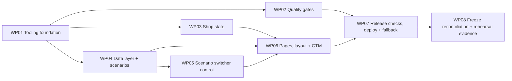

# Work Packages: Demo Shop

**Inputs**: Design documents from `kitty-specs/demo-shop-01M5QW5Y/`
**Prerequisites**: plan.md, spec.md, research.md (R-01…R-12), data-model.md, contracts/ (datalayer-pushes, scenario-url, gates-cli), quickstart.md
**Decisions in force**: `DM-01M5QXTJSS08GV3TDMWA59QCGY` (GTM ID injection at build), `DM-01M5QXTNC6EKYRJP56QZ5JXSCJ` (Cloudflare Pages Git integration + Actions gates), `DM-01M5QXTQXTG6ASW9E96GQM6ARX` (supporting dev dependencies), `DM-01M5QYJ3YM1435E0GJEG301ZF4` (`@types/node` allowed as a type-only dev dependency, confirmed at this step).

**Tests**: No test framework (QDR-003). Verification is the four gates, `pnpm verify:scenarios` (FR-012) and the manual pre-rehearsal check in quickstart.md.

**Organization**: Fine-grained subtasks (`Txxx`) roll up into work packages (`WPxx`). Each work package is independently deliverable and reviewable.

**Prompt Files**: Each work package has a prompt file in `tasks/`. This file is the high-level checklist; implementation detail lives in the prompts.

## Subtask Format: `Txxx [P?] Description (WPxx)`

- **[P]** means the subtask can proceed in parallel with its siblings (different files or concerns).
- Subtasks are **reference rows**, not checkboxes: record completion with `spec-kitty agent tasks mark-status <Txxx> --status done`.

## Dependency graph

Parallel after WP01: WP02, WP03 and WP04 have disjoint files and no shared dependency beyond WP01. WP05 can start as soon as WP04 lands, while WP03 is still in flight.

## Subtask Index (reference only, not a tracking surface)

| ID | Description | WP | Parallel |
|---|---|---|---|
| T001 | `package.json`, `.node-version`, `packageManager`, scripts | WP01 | |
| T002 | `pnpm-workspace.yaml` supply-chain settings, install dev deps, lockfile | WP01 | |
| T003 | `tsconfig.json` (erasable-only, `.ts` imports, DOM + Node types) | WP01 | [P] |
| T004 | `eslint.config.js` with R-08 rules, each rule proven to fire | WP01 | [P] |
| T005 | `.gitignore` additions and `site/src/globals.d.ts` | WP01 | [P] |
| T006 | `AGENTS.md`: tooling, exact gate commands, deploy and supply-chain notes | WP01 | |
| T007 | `scripts/lib/git.ts` and `scripts/lib/report.ts` | WP02 | |
| T008 | `scripts/no-secrets.ts` | WP02 | [P] |
| T009 | `scripts/provenance.ts` | WP02 | [P] |
| T010 | `scripts/gates.ts` runner (`--pre-push`, `--ci`) | WP02 | |
| T011 | `.githooks/pre-push` and LF attribute | WP02 | [P] |
| T012 | `.github/workflows/gates.yml` | WP02 | [P] |
| T013 | Prove every gate can fail (negative checks) | WP02 | |
| T014 | `site/src/shop/catalogue.ts` (fictional products, hero £12.99) | WP03 | [P] |
| T015 | `site/src/shop/storage.ts` (safe sessionStorage, memory fallback) | WP03 | |
| T016 | `site/src/shop/basket-store.ts` | WP03 | |
| T017 | `site/src/shop/order-store.ts` (order lifecycle, `pushed` guard) | WP03 | |
| T018 | `site/src/datalayer/events.ts` (builders, amounts, transaction ID) | WP04 | |
| T019 | `site/src/datalayer/scenarios.ts` (registry, one-difference `apply`) | WP04 | |
| T020 | `site/src/datalayer/push.ts` (only `dataLayer` writer) | WP04 | |
| T021 | `site/src/switcher/scenario-url.ts` (parse, format, normalise) | WP04 | [P] |
| T022 | `scripts/verify-scenarios.ts` (FR-012 invariants) | WP04 | |
| T023 | Switcher control: native `<select>` mounted into a container | WP05 | |
| T024 | Change handling: `pushState`, link rewriting, `scenariochange` event | WP05 | |
| T025 | `popstate` sync and address normalisation on mount | WP05 | |
| T026 | Isolated keyboard and no-push verification | WP05 | |
| T027 | `vite.config.ts`: MPA inputs and GTM injection plugin | WP06 | |
| T028 | Five HTML documents and `public/favicon.svg` | WP06 | |
| T029 | `site/src/ui/` layout, styles and inline SVG art | WP06 | |
| T030 | Listing and product pages, `add_to_cart` wiring | WP06 | |
| T031 | Basket page | WP06 | [P] |
| T032 | Checkout page, Place order | WP06 | |
| T033 | Thank-you page: `purchase` on load, reload guard, Order again | WP06 | |
| T034 | Full gate run on the merged tree, CI first green run | WP07 | |
| T035 | Production deploy on Cloudflare Pages and first-deploy verification | WP07 | |
| T036 | Local fallback verification with no network | WP07 | [P] |
| T037 | NFR sweep: speed, network origins, keyboard, no Console output | WP07 | [P] |
| T038 | `README.md` presenter runbook and `docs/release-checks.md` evidence | WP07 | |
| T039 | W2 freeze reconciliation (FR-024, after Tue 27 Oct) | WP08 | |
| T040 | Pre-rehearsal check ×10 with the snippet installed, logged | WP08 | |
| T041 | No-snippet run, talk timing and rehearsal sign-off record | WP08 | |

---

## Phase 1 – Setup

## Work Package WP01: Tooling foundation (Priority: P0)

**Goal**: Fixed toolchain (pnpm 10, Vite multi-page, TypeScript, ESLint, `@types/node`) installed with supply-chain settings, lint rules that close FR-017/FR-016/NFR-004 defects by construction, and `AGENTS.md` recording tooling and exact gate commands.
**Independent Test**: `pnpm install --frozen-lockfile` succeeds on a clean clone; `pnpm lint` and `pnpm exec tsc --noEmit` exit 0; each R-08 lint rule is shown to fire on a scratch file.
**Prompt**: `tasks/WP01-tooling-foundation.md`
**Requirement Refs**: FR-023, C-009, C-003
**Estimated prompt size**: ~420 lines

### Included Subtasks

T001 `package.json`, `.node-version`, `packageManager`, scripts (WP01)
T002 `pnpm-workspace.yaml` supply-chain settings, install dev deps, lockfile (WP01)
T003 [P] `tsconfig.json` (erasable-only, `.ts` imports, DOM + Node types) (WP01)
T004 [P] `eslint.config.js` with R-08 rules, each rule proven to fire (WP01)
T005 [P] `.gitignore` additions and `site/src/globals.d.ts` (WP01)
T006 `AGENTS.md`: tooling, exact gate commands, deploy and supply-chain notes (WP01)

### Implementation Notes

- Order: T001 → T002 (install) → T003/T004/T005 in any order → T006 last (records the installed versions).
- All `package.json` scripts from contracts/gates-cli.md are declared now, even where the target file arrives in a later WP.

### Parallel Opportunities

- T003, T004 and T005 touch separate files.

### Dependencies

- None (starting package).

### Risks & Mitigations

- `eslint .` would crawl `.worktrees/` (Spec Kitty lane worktrees): ignore it explicitly.
- Global pnpm on the dev machine is 12.x: rely on `packageManager` + corepack so pnpm 10 is used.
- `prepare` sets `core.hooksPath` repo-wide (shared by all worktrees). Harmless until WP02 adds `.githooks/pre-push`.

---

## Phase 2 – Foundational (parallel after WP01)

## Work Package WP02: Quality gates (Priority: P0)

**Goal**: `pnpm gates` runs lint → build → no-secrets → provenance, stops at the first failure, and also runs as a pre-push hook and in GitHub Actions. No-secrets and provenance follow R-09/R-10 exactly, and provenance never echoes a term.
**Independent Test**: Each gate script runs on its own and fails on a deliberately bad input, created at runtime and never committed. The runner prints `[n/4]` headers and stops at the first failure.
**Prompt**: `tasks/WP02-quality-gates.md`
**Requirement Refs**: FR-018, FR-019, FR-020, C-003, C-005
**Estimated prompt size**: ~520 lines

### Included Subtasks

T007 `scripts/lib/git.ts` and `scripts/lib/report.ts` (WP02)
T008 [P] `scripts/no-secrets.ts` (WP02)
T009 [P] `scripts/provenance.ts` (WP02)
T010 `scripts/gates.ts` runner (`--pre-push`, `--ci`) (WP02)
T011 [P] `.githooks/pre-push` and LF attribute (WP02)
T012 [P] `.github/workflows/gates.yml` (WP02)
T013 Prove every gate can fail (negative checks) (WP02)

### Implementation Notes

- T007 first (shared helpers), then T008/T009 in parallel, then T010, then T011/T012, then T013.
- Until WP06 lands, the build gate fails on this lane because there are no pages yet. This is expected. Verify the other gates individually; the full green run is WP07/T034.

### Parallel Opportunities

- T008 and T009; T011 and T012.

### Dependencies

- Depends on WP01.

### Risks & Mitigations

- Self-matching regexes, term leakage through exceptions, Windows `.cmd` spawning (Node 24 refuses to spawn `.cmd` without a shell), CRLF in the hook. Each has a mitigation in the prompt.

---

## Work Package WP03: Shop state – catalogue, basket and order (Priority: P1)

**Goal**: Pure, DOM-free TypeScript modules for the fictional catalogue (hero product SKU-1001 at 1299 pence), safe sessionStorage with an in-memory fallback, the basket, and the order lifecycle with its `pushed` guard (R-03, R-07).
**Independent Test**: `pnpm exec tsc --noEmit` and `pnpm lint` pass. A throwaway Node script (not committed) importing the modules shows add/increment/total, place order/clear basket, mark pushed and order again, including when storage throws.
**Prompt**: `tasks/WP03-shop-state.md`
**Requirement Refs**: FR-001, C-001, C-010
**Estimated prompt size**: ~330 lines

### Included Subtasks

T014 [P] `site/src/shop/catalogue.ts` (fictional products, hero £12.99) (WP03)
T015 `site/src/shop/storage.ts` (safe sessionStorage, memory fallback) (WP03)
T016 `site/src/shop/basket-store.ts` (WP03)
T017 `site/src/shop/order-store.ts` (order lifecycle, `pushed` guard) (WP03)

### Implementation Notes

- T014 is independent; T015 → T016 → T017.
- No imports from `datalayer/` or `switcher/`, so this WP stays parallel with WP04. The order stores `scenario` as a plain string, and the transaction ID is passed in by the caller.

### Parallel Opportunities

- Whole WP runs alongside WP02 and WP04.

### Dependencies

- Depends on WP01.

### Risks & Mitigations

- Float drift: all money in integer pence here; conversion to push amounts lives in WP04.
- Private-mode storage throws: every access goes through `storage.ts`.

---

## Work Package WP04: Data layer pushes and scenarios (Priority: P1) 🎯 MVP core

**Goal**: The only module that writes to `window.dataLayer`. It holds the correct `add_to_cart`/`purchase` builders, the six-entry scenario registry whose broken entries each differ from the correct `purchase` in exactly one way, the scenario URL helpers, and `pnpm verify:scenarios`.
**Independent Test**: `pnpm verify:scenarios` exits 0 and fails if any scenario is altered to make two differences. Builders produce exactly the objects in contracts/datalayer-pushes.md.
**Prompt**: `tasks/WP04-datalayer-and-scenarios.md`
**Requirement Refs**: FR-004, FR-005, FR-006, FR-007, FR-008, FR-009, FR-010, FR-011, FR-012, FR-016, FR-017
**Estimated prompt size**: ~500 lines

### Included Subtasks

T018 `site/src/datalayer/events.ts` (builders, amounts, transaction ID) (WP04)
T019 `site/src/datalayer/scenarios.ts` (registry, one-difference `apply`) (WP04)
T020 `site/src/datalayer/push.ts` (only `dataLayer` writer) (WP04)
T021 [P] `site/src/switcher/scenario-url.ts` (parse, format, normalise) (WP04)
T022 `scripts/verify-scenarios.ts` (FR-012 invariants) (WP04)

### Implementation Notes

- T018 → T019 → T020; T021 after T019 (needs the registry); T022 last.
- `events.ts` and `scenarios.ts` must be importable by Node directly (type stripping): no DOM, `.ts` import extensions, erasable syntax only.

### Parallel Opportunities

- T021 alongside T020.

### Dependencies

- Depends on WP01.

### Risks & Mitigations

- Scenario 2 must push the literal string `"12.99"` (R-05). Scenario 3 renames the key and keeps its value. `pushed`-guard ordering is WP06's responsibility, using the API here.

---

## Phase 3 – User stories

## Work Package WP05: Scenario switcher control (Priority: P1)

**Goal**: A self-contained, keyboard-operable native `<select>` labelled "Scenario". It lists scenarios in talk-script order and changes the scenario with `history.pushState`. It rewrites internal links, follows back/forward, normalises unknown values with `replaceState`, and never pushes to the data layer.
**Independent Test**: On a scratch page (not committed) under `pnpm dev`, choosing each option updates the address with no `dataLayer` growth. Back and forward resync the control, and an unknown `?scenario=` is rewritten to `correct` without a new history entry.
**Prompt**: `tasks/WP05-scenario-switcher.md`
**Requirement Refs**: FR-013, FR-014, FR-015, NFR-002, NFR-005
**Estimated prompt size**: ~300 lines

### Included Subtasks

T023 Switcher control: native `<select>` mounted into a container (WP05)
T024 Change handling: `pushState`, link rewriting, `scenariochange` event (WP05)
T025 `popstate` sync and address normalisation on mount (WP05)
T026 Isolated keyboard and no-push verification (WP05)

### Implementation Notes

- One file, `site/src/switcher/switcher.ts`. It exports `mountScenarioSwitcher(container)` and `syncScenarioLinks(root)`; WP06's layout calls them.

### Parallel Opportunities

- Runs alongside WP03 once WP04 is merged.

### Dependencies

- Depends on WP04.

### Risks & Mitigations

- Must not import `push.ts` (lint forbids `dataLayer` outside it; review confirms no import).

---

## Work Package WP06: Pages, layout and GTM install (Priority: P1)

**Goal**: Five thin, plausible pages for a fictional brand. Each creates `window.dataLayer` before GTM, then loads the shop's GTM container when an ID was supplied at build. The pages wire the shop actions: add to basket pushes `add_to_cart` on click, Place order saves the order, and the thank-you page pushes `purchase` once on load.
**Independent Test**: Run `pnpm build && pnpm preview` with no GTM ID, then walk listing → product → add to basket → basket → checkout → Place order → thank-you. `window.dataLayer` holds exactly `{ecommerce:null}` + `add_to_cart`, then `{ecommerce:null}` + `purchase`. Reloading thank-you adds nothing. With an ID set, the head contains the GTM snippet after the data layer script on every page.
**Prompt**: `tasks/WP06-pages-layout-gtm.md`
**Requirement Refs**: FR-001, FR-002, FR-003, FR-004, FR-005, FR-006, FR-016, FR-017, NFR-001, NFR-004, NFR-005, C-001, C-010, C-011
**Estimated prompt size**: ~560 lines

### Included Subtasks

T027 `vite.config.ts`: MPA inputs and GTM injection plugin (WP06)
T028 Five HTML documents and `public/favicon.svg` (WP06)
T029 `site/src/ui/` layout, styles and inline SVG art (WP06)
T030 Listing and product pages, `add_to_cart` wiring (WP06)
T031 [P] Basket page (WP06)
T032 Checkout page, Place order (WP06)
T033 Thank-you page: `purchase` on load, reload guard, Order again (WP06)

### Implementation Notes

- T027 → T028 → T029, then pages T030–T033. `purchase` is pushed on thank-you load, not on click (R-03).

### Parallel Opportunities

- T031 alongside T030 once the layout exists.

### Dependencies

- Depends on WP03, WP04, WP05.

### Risks & Mitigations

- Never paste Google's placeholder container ID into code; the plugin interpolates the env value only. A missing or invalid ID gives a build warning naming the variable, and no GTM tag.

---

## Phase 4 – Release and rehearsal

## Work Package WP07: Release checks, deploy and local fallback (Priority: P2)

**Goal**: The merged tree passes all four gates locally and in CI. The shop is live on `demo.quadrano.com` via Cloudflare Pages Git integration, with the container ID only in Pages build variables. The offline local build works. NFR-001/004/005 and FR-017 are checked and recorded. The README carries the presenter runbook.
**Independent Test**: `pnpm gates` exits 0 on the merged tree; CI is green; `demo.quadrano.com` serves the shop with GTM; `pnpm build && pnpm preview` works with the network off; `docs/release-checks.md` records each check with date and result.
**Prompt**: `tasks/WP07-release-deploy-fallback.md`
**Requirement Refs**: FR-018, FR-021, FR-022, NFR-001, NFR-004, NFR-005, C-002, C-003
**Estimated prompt size**: ~400 lines

### Included Subtasks

T034 Full gate run on the merged tree, CI first green run (WP07)
T035 Production deploy on Cloudflare Pages and first-deploy verification (WP07)
T036 [P] Local fallback verification with no network (WP07)
T037 [P] NFR sweep: speed, network origins, keyboard, no Console output (WP07)
T038 `README.md` presenter runbook and `docs/release-checks.md` evidence (WP07)

### Implementation Notes

- Cloudflare dashboard, GitHub secret and branch-protection steps are **Product Owner actions** (quickstart "Deploy"). The implementer prepares the checklist, waits for confirmation, then verifies.

### Parallel Opportunities

- T036 and T037 while waiting for the Product Owner's deploy setup.

### Dependencies

- Depends on WP02, WP06.

### Risks & Mitigations

- Cloudflare build image may ignore `packageManager` or block esbuild's postinstall (research A7). Check the first build log, and record any `onlyBuiltDependencies` change in `AGENTS.md` (an out-of-map edit, noted).

---

## Work Package WP08: Freeze reconciliation and rehearsal evidence (Priority: P1, date-gated)

**Goal**: After the W2 freeze (Tue 27 Oct 2026), reconcile Attribute names, types and the `transaction_id` pattern with the confirmed Event Definitions. Then prove all 7 scenario outcomes produce their expected Console group verbatim in 10 of 10 runs, with zero verdict lines when the snippet is absent, and the shop part of the talk in under 3 minutes.
**Independent Test**: `docs/rehearsal-log.md` shows the freeze comparison result, 10 dated runs of the quickstart pre-rehearsal table with every row matching character for character, the no-snippet run, and a timed walk-through.
**Prompt**: `tasks/WP08-freeze-and-rehearsal.md`
**Requirement Refs**: FR-024, NFR-003, C-004, C-008
**Estimated prompt size**: ~330 lines

### Included Subtasks

T039 W2 freeze reconciliation (FR-024, after Tue 27 Oct) (WP08)
T040 Pre-rehearsal check ×10 with the snippet installed, logged (WP08)
T041 No-snippet run, talk timing and rehearsal sign-off record (WP08)

### Implementation Notes

- Blocked until (a) the freeze has happened and (b) the "Demo Shop" Specification snippet exists in the shop's GTM container. Both are external (C-007). If either is not ready, block with a structured report (QDR-006), and do not improvise.
- FR-024 may require small edits in `site/src/datalayer/*` and `contracts/datalayer-pushes.md` (owned by WP04 and planning). These are justified out-of-map edits, recorded in the activity log.

### Parallel Opportunities

- None; sequential by nature.

### Dependencies

- Depends on WP07.

### Risks & Mitigations

- Nested Event Definitions may not ship in Quadrano Local by the freeze (spec Assumptions). That is the Product Owner's decision, not the implementer's. Stop and escalate.

---

## Summary

| WP | Title | Subtasks | Est. lines | Depends on | Profile |
|---|---|---|---|---|---|
| WP01 | Tooling foundation | 6 | ~420 | none | node-norris |
| WP02 | Quality gates | 7 | ~520 | WP01 | node-norris |
| WP03 | Shop state | 4 | ~330 | WP01 | frontend-freddy |
| WP04 | Data layer and scenarios | 5 | ~500 | WP01 | frontend-freddy |
| WP05 | Scenario switcher control | 4 | ~300 | WP04 | frontend-freddy |
| WP06 | Pages, layout and GTM | 7 | ~560 | WP03, WP04, WP05 | frontend-freddy |
| WP07 | Release checks, deploy and fallback | 5 | ~400 | WP02, WP06 | implementer-ivan |
| WP08 | Freeze reconciliation and rehearsal | 3 | ~330 | WP07 | implementer-ivan |

MVP: WP01 → WP04 → WP03/WP05 → WP06 gives a locally demoable shop with every scenario. WP02 can run in parallel; WP07/WP08 make it live and proven.
