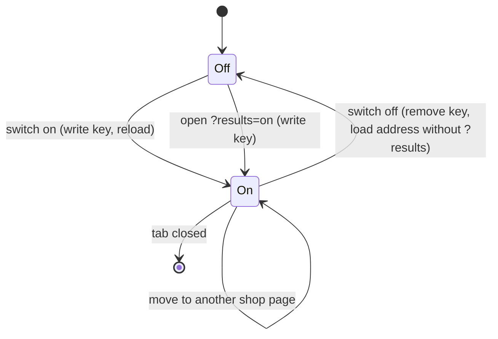

# Data Model: On-page results mirror

Phase 1 of [plan.md](plan.md). Nothing here is sent anywhere. Only the setting is stored.

## Results view setting

| Field | Value | Where |
|---|---|---|
| key | `demo-shop:results-view` | `sessionStorage` |
| value | `on`, or absent | |

- **On** when the key holds `on`, or the address carries `results=on`.
- Any other stored value or parameter value is treated as absent.
- Lifetime: this tab. A new tab starts off.
- Written by the capture script (when the link is used) and by the switch. Removed by the switch.

With storage blocked there is one extra state: **on for this page only**, entered by the link and left by the switch or by any navigation.

## Capture state (page memory)

Held by the capture script on `window.__demoShopResults`. It exists only when the view is on.

| Field | Type | Meaning |
|---|---|---|
| `bannerSeen` | boolean | the runtime's banner line has reached the Console on this page |
| `entries` | list of Result or Plain line | oldest first, at most 50 |
| `listen(fn)` | function | registers the one listener; it is called after each change |
| `storage` | `'ok'` or `'unavailable'` | whether the setting could be read |

Invariants:

- The Console call is made before the state changes.
- An entry is added only when its shape matched (research R-05).
- `entries` never exceeds 50; the oldest is dropped first.
- Nothing in this state is written to storage or put in a request.

## Result

The runtime's Console group for one push.

| Field | Type | From |
|---|---|---|
| `kind` | `'group'` | |
| `header` | string | the group's format string with `%c` removed and `%s` filled |
| `lines` | list of string | each one-argument `log` inside the group, in order (0 or more) |
| `pushed` | string or null | the two-argument `log`: first argument, a space, then the object as 2-space-indented JSON taken at call time |

Lifecycle: opened by a matching `groupCollapsed`, filled by `log` calls, added to `entries` on its `groupEnd`. While it is open, a group started by another script is counted and its contents are ignored until its own `groupEnd`.

## Plain line

A branded single line written outside a group, other than the banner.

| Field | Type | From |
|---|---|---|
| `kind` | `'line'` | |
| `text` | string | the format string with `%c` removed and `%s` filled |

## Runtime banner line

Not kept as an entry. Its arrival sets `bannerSeen` to true and never back.

## What Results shows

| `bannerSeen` | `entries` | Shown |
|---|---|---|
| false | empty | the "hasn't loaded" message |
| true | empty | "No output yet" |
| either | 1 or more | the rows, newest first |
