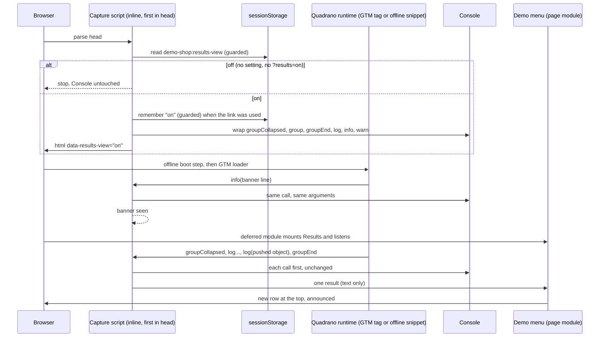

# Implementation Plan: On-page results mirror

**Branch**: `feat/on-page-results-mirror` (planning base and merge target; reaches `main` by PR) | **Date**: 2026-11-12 | **Spec**: [spec.md](spec.md)
**Input**: Mission specification from `kitty-specs/on-page-results-mirror-01M78JHF/spec.md`

Planning decisions: `DM-01M78NYDDTDCEGEP0S4BDQDNKM` (the setting is remembered for this tab only) and `DM-01M78PK9GGHZSS6RFEYXKK4PXS` (Quadrano's single lines are shown as plain rows). Engineering alignment confirmed by the Product Owner on 2026-11-12.

## Summary

A small inline script in `<head>`, placed before the offline boot step and the GTM loader, decides whether the Results view is on. It is on when `sessionStorage` holds the setting or the address carries `?results=on`. When the view is off the script stops there: the Console methods stay the browser's own and no request is added.

When the view is on, the script wraps six Console methods. Each wrapper calls the browser's method first with the same arguments, then keeps a copy of any call that has the shape of Console output format v1. Copies live in memory on the page and nowhere else.

The Demo menu gains a Results section directly under the Event playground. It holds the switch, the two empty states and one row per result, newest first. Row text comes only from the runtime's own arguments. The shop holds no verdict mark or wording, and the lint rule against Console use is relaxed for the one capture file only.

Charter 1.2.0 (minor) records that the shop may repeat the runtime's Console output and still never judges a push.



## Technical Context

**Language/Version**: TypeScript 5.9.3 (erasable syntax only), run by Node 24.15.0 for scripts. The capture script is written as ES5-compatible TypeScript because it runs inline before anything else.
**Primary Dependencies**: Vite 8.3.4 (the existing `quadrano-gtm` plugin gains one more inline script; `transformWithOxc` strips its types). No runtime dependencies. No new dev dependencies (C-005).
**Storage**: Browser `sessionStorage`, one key `demo-shop:results-view` holding `on`. Results are held in page memory only and are never stored (FR-011).
**Testing**: The four gates are unchanged (lint, build, no-secrets, provenance). Non-gate checks: a new `pnpm verify:results` (the lint rule still fires outside the capture file; the capture file is self-contained), and `pnpm test:e2e` extended with a Results suite that serves the real snippet fixture on the shop's container path, on a visitor's own container and in the offline build. Manual: real iPhone and Android check (FR-017) and a Lighthouse mobile run with the view off (NFR-004).
**Target Platform**: Static site on Cloudflare Pages at `demo.quadrano.com`. Evergreen desktop and mobile browsers, including Safari on iOS and Chrome on Android.
**Project Type**: single (static multi-page web site)
**Performance Goals**: LCP at most 2 s per page with the view off (NFR-004). The capture script is about 1 KB inline and adds no request. The Results code is imported statically by the menu, so it adds no request either.
**Constraints**: with the view off, Console methods are the browser's own (FR-005); every Console call still reaches the Console first, unchanged (FR-007); lines are recognised by shape only (FR-008); the address never sets a container (C-002); no verdict wording in `site/` (FR-014); 0 px horizontal overflow at 360 px (NFR-001); the contract and the runtime are untouched (C-001); merge to `main` before Thu 19 Nov 2026 only if FR-017 is recorded (C-004).
**Scale/Scope**: 5 pages, 1 storage key, 1 link parameter, 3 new source files, 1 new e2e suite (3 spec files and 1 helper file), 1 new verify script, 1 Charter minor amendment. At most 50 results are kept per page.

## Charter Check

*GATE: Must pass before Phase 0 research. Re-checked after Phase 1 design.*

| Rule | Status | How the plan holds it |
|---|---|---|
| QDR-001 Provenance | Pass | All code is original. No prior venture is named. |
| QDR-002 Approved stack | Pass | Still a static site with one container per page. The link parameter is read by a separate script that never touches the container choice. `active-container.ts` and its build-time address check are unchanged. No dependency is added. |
| QDR-003 Minimal gates | Pass | Gate set and order unchanged. `verify:results` and the new e2e suite are non-gate, like the existing `verify:*` scripts. |
| QDR-004 No secrets | Pass | No container ID is written anywhere. Tests keep building IDs at run time. |
| QDR-005 Contract | Pass | The contract and runtime are untouched (C-001). The shop reads Console output format v1 by its shape; the e2e suite against the real snippet fixture fails if that shape changes (NFR-003). |
| QDR-006 Escalation | Pass | Two open points were put to the Product Owner and resolved before planning. |
| QDR-007 Amendments | Pass | Minor 1.2.0 (the Charter didn't state the "never judges" rule before, so the amendment adds it), proposed here by the Architect: version and date, `charter.yaml` kept in agreement, reasoning in the commit, amendment-log row, and the lint change in the same pull request. Text in [contracts/charter-amendment.md](contracts/charter-amendment.md). |
| Terminology Canon | Pass | No new domain terms. "Results" and "result" are UI names (spec, Domain Language). |
| No shop verdicts (demo-shop FR-017) | **Pass after amendment** | `no-console` is turned off for `site/src/results/console-mirror.ts` only. The verdict-wording rule stays on for every file in `site/`, including that one. `verify:results` proves the rule still fires elsewhere (FR-014, SC-008). |
| DIRECTIVE_051 Supply chain | Not applicable | The plan adds, upgrades and removes no dependency, so no control applies and no adversarial pass is needed. |

Post-design re-check (after Phase 1): no new violations. One point to hold in review: the capture script reads `location.search`. It lives in `site/src/results/`, outside `site/src/container/**`, and shares no code with the container loader, so the existing address rule is neither weakened nor exempted.

## Project Structure

### Documentation (this mission)

```
kitty-specs/on-page-results-mirror-01M78JHF/
├── spec.md
├── plan.md              # this file
├── research.md          # Phase 0: R-01 … R-10
├── data-model.md        # Phase 1: setting, capture state, result, plain line
├── quickstart.md        # Phase 1: run, verify, device check
├── contracts/
│   ├── console-capture.md     # head script, shapes recognised, page interface
│   ├── results-view.md        # menu section, switch, link, copy, a11y
│   └── charter-amendment.md   # Charter 1.2.0 text and mechanism
└── tasks.md             # /spec-kitty.tasks (not created here)
```

### Source Code (repository root)

```
site/
├── *.html, */index.html           # unchanged; the <!-- gtm:head --> marker gains one script
└── src/
    ├── results/
    │   ├── console-mirror.ts      # NEW, self-contained, ES5-safe: setting, wrappers, shape rules (inlined into <head>)
    │   └── results-setting.ts     # NEW: guarded sessionStorage write/clear and the address without ?results
    ├── menu/
    │   ├── results.ts             # NEW: Results section (switch, empty states, rows, live region)
    │   └── visitor-menu.ts        # CHANGED: mounts Results under the playground; guidance copy
    ├── globals.d.ts               # CHANGED: type of window.__demoShopResults
    └── ui/styles.css              # CHANGED: Results styles, wrapping at 360 px
vite.config.ts                     # CHANGED: inlines console-mirror.ts before the offline boot step and GTM loader
eslint.config.js                   # CHANGED: no-console off for site/src/results/console-mirror.ts only
scripts/verify-results.ts          # NEW: lint still fires elsewhere; capture file self-contained
package.json                       # CHANGED: "verify:results" script
playwright.config.ts               # CHANGED: the offline project also runs the offline Results cases
e2e/
├── results.spec.ts                # NEW: rows and capture on the shop's container and a visitor's own container
├── results-setting.spec.ts        # NEW: off state, switch, link, container rule, no pushes, storage
├── results-offline.spec.ts        # NEW: the same verbatim check in the offline build
├── results-helpers.ts             # NEW: helpers shared by the three Results spec files
├── a11y.spec.ts, layout.spec.ts   # CHANGED: matrices gain "view on, empty" and "view on, 5 results"
└── snippets.ts                    # CHANGED: helper returning a fixture snippet's script body
.kittify/charter/charter.md, charter.yaml   # CHANGED: 1.2.0
AGENTS.md, README.md, docs/release-checks.md # CHANGED: code rules, operator notes, evidence
```

**Structure Decision**: single static site, as today. The capture code sits in its own directory, `site/src/results/`, so the lint exception names one file and the container directory's address rule is untouched. The menu section follows the existing pattern of `site/src/menu/playground.ts`: one module mounted by `visitor-menu.ts`.

## Complexity Tracking

No Charter Check violations to justify.

## Implementation Concern Map

### IC-01 — Capture script and build wiring

- **Purpose**: Decide on/off before any other script runs and, when on, copy Console calls that have the runtime's shape without changing what the Console receives.
- **Relevant requirements**: FR-003, FR-005, FR-006, FR-007, FR-008, FR-009, FR-011, C-001, C-002, C-006
- **Affected surfaces**: `site/src/results/console-mirror.ts`, `vite.config.ts`, `site/src/globals.d.ts`
- **Sequencing/depends-on**: none
- **Risks**: The script must sit before the offline boot step, or the offline build never sees the banner line. A throw in the copy step must never stop the Console call. The file must stay free of imports and of a closing script tag, as `active-container.ts` does. See [contracts/console-capture.md](contracts/console-capture.md).

### IC-02 — Results section in the Demo menu

- **Purpose**: Show the switch, the empty states and the rows, and announce new results without moving focus.
- **Relevant requirements**: FR-001, FR-002, FR-004, FR-006, FR-010, FR-012, FR-013, FR-016 (menu guidance), NFR-001, NFR-002
- **Affected surfaces**: `site/src/menu/results.ts`, `site/src/results/results-setting.ts`, `site/src/menu/visitor-menu.ts`, `site/src/ui/styles.css`
- **Sequencing/depends-on**: IC-01 (the page interface)
- **Risks**: Turning the switch off while the address still carries `?results=on` would turn the view straight back on, so "off" must load the address without the parameter. The playground already announces "Pushed …" in the layout's live region, so Results needs its own region or one announcement overwrites the other. All text is set as text, never as markup. See [contracts/results-view.md](contracts/results-view.md).

### IC-03 — Lint exception and its proof

- **Purpose**: Relax the Console rule for the capture file only and prove it still fires everywhere else.
- **Relevant requirements**: FR-014, SC-008, C-005
- **Affected surfaces**: `eslint.config.js`, `scripts/verify-results.ts`, `package.json`
- **Sequencing/depends-on**: IC-01 (the file the exception names) and IC-02 (`results-setting.ts`, whose storage key the verify script compares with the capture file's)
- **Risks**: Lands in the same pull request as the Charter amendment (QDR-007). The verdict-wording rule must stay on for the capture file. A fixture that breaks the rule can't sit on disk under `site/`, or `pnpm lint` itself fails; see research R-08.

### IC-04 — End-to-end proof

- **Purpose**: Prove verbatim text against the real snippet fixture on the shop's container, a visitor's own container and the offline build (FR-009), and prove the off state, the link, the switch and the no-push rule with their positive controls.
- **Relevant requirements**: NFR-001, NFR-002, NFR-003, SC-001 to SC-005, SC-007, FR-005, FR-007, FR-009, FR-011, FR-012
- **Affected surfaces**: `e2e/results.spec.ts`, `e2e/results-setting.spec.ts`, `e2e/results-offline.spec.ts`, `e2e/results-helpers.ts`, `e2e/a11y.spec.ts`, `e2e/layout.spec.ts`, `e2e/snippets.ts`, `playwright.config.ts`
- **Sequencing/depends-on**: IC-01, IC-02
- **Risks**: Expected text must come from the Console arguments captured in the same test run, not from strings typed into the test, or the test can't catch a format change. Every "nothing changed" check needs its paired control from the spec.

### IC-05 — Charter 1.2.0 and documents

- **Purpose**: Make the rulebook and the guidance match the shop.
- **Relevant requirements**: FR-015, FR-016, C-003
- **Affected surfaces**: `.kittify/charter/charter.md`, `.kittify/charter/charter.yaml`, `AGENTS.md`, `README.md`
- **Sequencing/depends-on**: IC-03 (same pull request as the lint change)
- **Risks**: The amendment is minor 1.2.0, not the patch first planned (spec, Assumptions); the old version must not be written by habit. Only the Architect proposes the text; implementers apply [contracts/charter-amendment.md](contracts/charter-amendment.md) as written.

### IC-06 — Device check and release evidence

- **Purpose**: Record that User Story 1 works on a real iPhone and a real Android phone, and that page speed holds with the view off.
- **Relevant requirements**: FR-017, SC-006, NFR-004, C-004
- **Affected surfaces**: `docs/release-checks.md`
- **Sequencing/depends-on**: IC-01 to IC-05 deployed to a preview
- **Risks**: Owner: the Product Owner, since it needs real phones. The mission doesn't reach `main` before the talk without this record (C-004). The C-004 statement is written in `docs/release-checks.md` and repeated in the pull request description, so it is in front of whoever merges.
