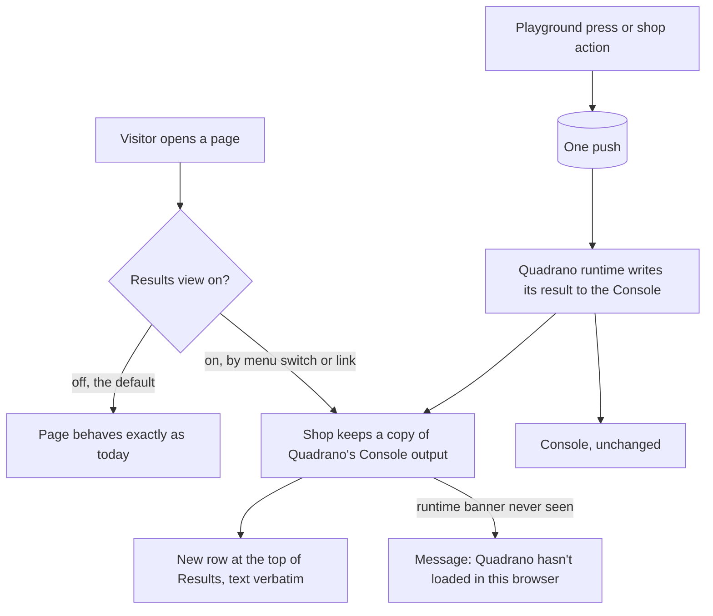

# Mission Specification: On-page results mirror

**Mission Branch**: `feat/on-page-results-mirror`
**Created**: 2026-11-12
**Status**: Approved (Product Owner, 2026-11-12). Amended 2026-11-13 at the Product Owner's request to resolve the findings of `/spec-kitty.analyze`: FR-002, FR-003, FR-004, FR-005, FR-015, C-004, SC-002, Key Entities and Assumptions. Scope is unchanged.
**Input**: GitHub issue Quadrano-Ltd/quadrano-demo-shop#10, "Show Quadrano's results on the page for attendees on phones (Console mirror in the Demo menu)". Discovery decision: `DM-01M78JJY73TNTBSZYYJD0Z50PZ` (ship before the talk, conditional on real-device checks). Intent Summary confirmed by the Product Owner on 2026-11-12.

## Purpose

Attendees following the talk on a phone can't see what Quadrano says about a push. The Quadrano runtime writes its results only to the browser Console, and a phone has no Console to open. On a phone the practical route is path 1 (the shop's own container) plus the Event playground, and the Demo menu's only guidance there is to open the Console.

This mission adds an opt-in Results view to the Demo menu. It repeats, on the page, exactly what the Quadrano runtime wrote to the Console for each push. The shop checks nothing itself, so "the shop pushes data and never judges it" (demo-shop-01M5QW5Y#FR-017) still holds: every verdict an attendee reads is Quadrano's own text.

The view is off by default, so the presenter's stage path is unchanged. A link can open the shop with the view already on, so a QR code on a slide takes attendees straight there.

An on-page Console panel was ruled out of scope for the bring-your-own-container mission (see #4, decision `DM-01M64RG96F8V6JBVY0AM5SA009`, byo-gtm-container-01M64PAZ#C-009). This mission reopens it as its own piece of work.

## User Scenarios & Testing *(mandatory)*

### User Story 1 - Read Quadrano's results on my phone (Priority: P1)

An attendee on a phone scans a QR code on a slide. The shop opens with the Results view on. They open the Demo menu and press a playground button. A new row appears at the top of the Results section, directly under the Event playground, showing the header line Quadrano wrote for that push. They expand the row and read the problem lines and the pushed object, word for word as the Console would show them.

**Why this priority**: This is the reason for the mission. Without it, attendees on phones see nothing of what Quadrano does.

**Independent Test**: Open the shop through the link with the shop's own container, press each of the 7 playground buttons, and compare each row's text with the Console group for the same push.

**Acceptance Scenarios**:

1. **Given** the view is on and Quadrano has loaded, **When** the visitor presses a playground button, **Then** exactly one new row appears at the top of Results whose text equals the Console group for that push, character for character.
2. **Given** several results, **When** the visitor looks at the list, **Then** the newest is first and each row can be expanded and collapsed on its own.
3. **Given** the view is on and no push has been made, **When** the visitor opens the menu, **Then** Results reads "No output yet".
4. **Given** the view is on and Quadrano's banner line has not appeared, **When** the visitor opens the menu, **Then** Results says that Quadrano hasn't loaded in this browser and that a content blocker stopping GTM is the likely cause on a phone.
5. **Given** the view is on, **When** the visitor moves to another shop page, **Then** the view is still on there, and Results starts empty for the new page.

---

### User Story 2 - The stage path is unchanged (Priority: P1)

The presenter opens the shop as they do today, with no link parameter and the switch never touched. Nothing about the page differs from today: the Console shows the Quadrano snippet as the source of each line, and the page makes the same requests.

**Why this priority**: The site is used on stage on Thu 19 Nov. A change that alters the default behaviour would put the talk at risk.

**Independent Test**: With the view off, check that the Console methods are the browser's own and that the page's requests match today's; then turn the view on, on the same page, and check that this differs (the positive control).

**Acceptance Scenarios**:

1. **Given** the view has never been turned on, **When** any page loads, **Then** the Console methods are the browser's own, no Results section content is kept, and the page makes the same requests as today.
2. **Given** the view is on, **When** the visitor turns the switch off, **Then** the page reloads and behaves as in scenario 1.
3. **Given** the view is on, **When** any script writes to the Console, **Then** the Console receives the same call, with the same arguments, in the same order as it would with the view off.

---

### User Story 3 - Turn the view on and off (Priority: P2)

A visitor who arrived without the link opens the Demo menu and turns on "Results". The page reloads with the view on. Later they turn it off the same way. A visitor who arrives through the link has the view on without touching the switch, and can turn it off.

**Why this priority**: The link covers most attendees; the switch covers everyone else and gives a way back.

**Independent Test**: Toggle the switch and check the view state after the reload; open the link and check the view is on; check that neither changes the container or makes a push.

**Acceptance Scenarios**:

1. **Given** the view is off, **When** the visitor turns the switch on, **Then** the choice is remembered, the page reloads, and the view is on.
2. **Given** a link carrying the results parameter, **When** the page opens, **Then** the view is on, exactly as if the switch had been used.
3. **Given** a link carrying the results parameter, **When** the page opens, **Then** the active container is the one it would have been without the parameter.
4. **Given** any state, **When** the visitor opens or closes the menu, uses the switch, or expands or collapses a row, **Then** no push is made.

---

### User Story 4 - Usable with a screen reader and at phone width (Priority: P2)

An attendee using a screen reader hears that a new result has arrived without losing their place. An attendee on a narrow phone can read every result without the page scrolling sideways.

**Why this priority**: The view exists for attendees on their own devices; it must not exclude some of them.

**Independent Test**: Run the automated accessibility check with the view on and results showing; operate the switch and rows by keyboard alone; check the layout at 360 px; repeat on a real iPhone and a real Android phone.

**Acceptance Scenarios**:

1. **Given** the view is on, **When** a new result arrives, **Then** it is announced to screen readers and focus stays where it was.
2. **Given** a 360 px wide viewport with the view on and at least 5 results, some expanded, **When** the visitor reads them, **Then** nothing overflows horizontally.
3. **Given** the view is on, **When** the visitor uses only a keyboard, **Then** they can reach and operate the switch and every row.

---

### Edge Cases

- **Quadrano never loads** (content blocker, GTM blocked, no snippet in a visitor's container, offline build with no snippet stored): Results shows the "hasn't loaded" message, not "No output yet".
- **Other scripts write Console groups** (a visitor's own container on path 2): lines that don't have Quadrano's shape reach the Console and are not shown in Results.
- **A push with no problems**: the row shows the header line and the pushed object, as the Console group does.
- **Pushed object holds markup-like or very long text**: it is shown as text, never run or rendered as page content, and wraps within the menu.
- **Browser storage unavailable or blocked**: the switch says the view can't be remembered in this browser; the link still turns the view on for the page it opens.
- **Link parameter with an unexpected value, or beside `?scenario=`**: an unrecognised value leaves the view as it was; the scenario link works as demo-shop-01M5QW5Y#FR-013 says.
- **Link parameter alongside a container-shaped parameter**: the container is still never taken from the address (byo-gtm-container-01M64PAZ#FR-013).
- **Many results on one page**: the list stays usable; the oldest results may be dropped beyond a stated limit set in the plan.
- **JavaScript disabled**: the view isn't available, as with the rest of the menu.

## Domain Language

The Terminology Canon applies unchanged. This mission adds no domain terms.

| Term | Use | Avoid |
|---|---|---|
| **Results** | The section of the Demo menu that repeats Quadrano's Console output (UI name, not a domain term) | "validation panel", "Console panel", "log viewer" |
| **Result** | One row in Results: the runtime's Console group for one push | "verdict" for anything the shop produces; the verdict is the runtime's |
| **Mirror / repeat** | What the shop does with the runtime's output | "validate", "check", "judge" for anything the shop does |
| **Console output format v1** | The runtime's output format in the published-artefact contract v1.0 | "log format" |

## Requirements *(mandatory)*

### Functional Requirements

| ID | Title | User Story | Priority | Status | Delivery | No-op passable? |
|----|-------|------------|----------|--------|----------|-----------------|
| FR-001 | Results section in the Demo menu | As an attendee on a phone, I want a Results section directly under the Event playground that lists results newest first, so that I can see what Quadrano said without a Console. | High | Open | [build] | no |
| FR-002 | One row per push | As an attendee, I want each push shown as one collapsible row holding the runtime's header line, its problem lines and the pushed object, so that each press maps to one result. A single line the runtime writes outside a group (a plain line, for example when an event has no Event Definition) is shown as a row of its own with nothing to expand (decision `DM-01M78PK9GGHZSS6RFEYXKK4PXS`). Each of the 7 playground presses gives exactly one result and no plain line. | High | Open | [build] | no |
| FR-003 | Text is the runtime's, verbatim | As the Product Owner, I want every character of a row's text to be what the runtime wrote to the Console for that push, so that every verdict seen is Quadrano's own. The header and problem lines are compared character for character. The Console shows the pushed object as a live object with no single text form, so the row shows the runtime's label followed by the object as indented JSON (2 spaces), taken when it was logged. | High | Open | [build] | no — compared against the Console group for the same push |
| FR-004 | Off by default, with a switch | As a visitor, I want a switch in the Demo menu that remembers my choice for this browser tab (decision `DM-01M78NYDDTDCEGEP0S4BDQDNKM`; a new tab starts off) and reloads the page, with the view off until I choose otherwise, so that I decide whether to see results. | High | Open | [build] | no |
| FR-005 | Off means unchanged | As the presenter, I want the page with the view off to have the browser's own Console methods and make the same requests as today, so that the stage path doesn't change. "The same requests as today" means this mission adds no request: with the view off, every request is same-origin or the one `gtm.js` request, and the request list is the same as with the view on. | High | Open | [ratchet] | yes — paired with FR-007 on the same page, where turning the view on must change what handles Console calls |
| FR-006 | A link that turns it on | As the presenter, I want a link parameter that opens the shop with the view on, behaving as the switch does and never choosing or changing the container, so that a QR code takes attendees straight to results. | High | Open | [build] | no — paired with a link carrying a container ID, which must not change the container |
| FR-007 | Console still gets everything | As a visitor with a Console, I want every Console call made while the view is on to reach the Console with the same arguments in the same order, so that turning the view on loses nothing. | High | Open | [build] | no |
| FR-008 | Only Quadrano's lines, recognised by shape | As the Product Owner, I want the shop to recognise the runtime's lines by the shape of Console output format v1 and never by verdict wording, and to show nothing written by other scripts, so that shop code holds no verdict text and other output stays out. | High | Open | [build] | no — paired with a non-Quadrano Console group on the same page, which must not appear |
| FR-009 | Works on every path | As a visitor, I want the view to work with the shop's own container, with my own container, and in the offline build, so that it doesn't matter how Quadrano reached the page. | High | Open | [build] | no |
| FR-010 | Empty states | As an attendee, I want Results to read "No output yet" before the first push, and to say that Quadrano hasn't loaded in this browser, naming a content blocker as the likely cause on a phone, when the runtime's banner line hasn't appeared, so that I know why I see nothing. | High | Open | [build] | no — the two states are checked against each other on the same page |
| FR-011 | Nothing leaves the page | As a visitor, I want the copies kept only for the life of the page and never stored or sent anywhere, so that what I push stays with me. | High | Open | [ratchet] | yes — paired with FR-001 on the same page, where results must be showing while storage and requests stay unchanged |
| FR-012 | The view pushes nothing | As the presenter, I want opening or closing the menu, using the switch, opening the link, and expanding or collapsing a row to make no push (demo-shop-01M5QW5Y#FR-015), so that the Console shows only intended pushes. | High | Open | [ratchet] | yes — paired with a playground press on the same page, which must push once |
| FR-013 | Announced without stealing focus | As a screen-reader user, I want each new result announced while focus stays where it is, so that I can follow results without losing my place. | Medium | Open | [build] | no |
| FR-014 | Still no shop verdicts | As the Product Owner, I want shop code to keep containing no verdict wording, and the rule against Console use in the shop relaxed only for the mirror and nowhere else (demo-shop-01M5QW5Y#FR-017), so that the exception can't spread. | High | Open | [ratchet] | yes — paired with a fixture that uses the Console outside the mirror, which lint must still fail |
| FR-015 | Charter minor amendment | As the Product Owner, I want the Charter amended (minor, 1.2.0) in this mission to say the shop may repeat the runtime's Console output on the page verbatim and still never produces a verdict of its own, following QDR-007 with its enforcing mechanism changed in the same pull request, so that the rulebook matches the shop. | High | Open | [build] | no |
| FR-016 | Documents and guidance match | As an operator or attendee, I want the `AGENTS.md` code rules, the README's operator notes and the Demo menu's guidance to describe the Results view, including how to reach it on a phone, so that nobody is told only to open a Console. | Medium | Open | [build] | no |
| FR-017 | Real-device check recorded | As the Product Owner, I want User Story 1 checked on one real iPhone and one real Android phone against production or a preview deployment, with the evidence recorded in the release checks, so that the view is known to work where it is needed. | High | Open | [build] | no |

### Non-Functional Requirements

| ID | Title | Requirement | Category | Priority | Status |
|----|-------|-------------|----------|----------|--------|
| NFR-001 | Phone width | At a 360 px wide viewport, with the view on and at least 5 results showing (at least 2 expanded), every page has 0 px of horizontal overflow. | Usability | High | Open |
| NFR-002 | Accessibility | Automated accessibility checks report 0 violations with the view on, both empty and with results; 100% of the view's controls work by keyboard alone. | Accessibility | High | Open |
| NFR-003 | Verbatim, proven against a real snippet | In an end-to-end test using a real Quadrano snippet fixture, 7 of 7 playground pushes produce a row equal to the Console group for that push, with the shop's own container path and in the offline build; the test fails if the runtime's format changes. | Reliability | High | Open |
| NFR-004 | Page speed holds | With the view off, each page's Largest Contentful Paint stays at most 2 seconds (Lighthouse mobile, default Slow 4G throttling), matching demo-shop-01M5QW5Y#NFR-001. | Performance | Medium | Open |

### Constraints

| ID | Title | Constraint | Category | Priority | Status |
|----|-------|------------|----------|----------|--------|
| C-001 | Contract unchanged | The published-artefact contract v1.0 and the runtime are untouched (QDR-005). The runtime gains no result event in this mission. | Business | High | Open |
| C-002 | Address never sets a container | The link parameter only turns the view on. The page address still never sets, changes or clears the container (QDR-002, byo-gtm-container-01M64PAZ#FR-013). | Security | High | Open |
| C-003 | Scope of the reversal | byo-gtm-container-01M64PAZ#C-009 is superseded for the on-page panel only. Setting the container from the page address, new event types and variants stay out of scope. | Business | High | Open |
| C-004 | Date and device checks | The mission reaches `main` before the talk on Thu 19 Nov 2026 only if FR-017 is recorded first. Otherwise it stays unmerged until after the talk. Held by the C-004 statement in `docs/release-checks.md`, repeated in the pull request description, and by the Product Owner, who alone merges to `main`. | Business | High | Open |
| C-005 | Gates, stack and terms | Every push passes lint, build, no-secrets and provenance (QDR-003). No new dependencies (QDR-002). QDR-001 and the Terminology Canon apply unchanged; no new domain terms. | Technical | High | Open |
| C-006 | The shop never judges | The shop makes no check of a push and writes no verdict of its own, on the page or in the Console. | Business | High | Open |

### Key Entities

- **Result**: the runtime's Console group for one push, as shown on the page: a header line, zero or more problem lines, and the pushed object as indented JSON. Exists only while the page is open.
- **Plain line**: a single line the runtime writes outside a group, shown as a row with its text and nothing to expand. It counts towards the limit on rows. The runtime's banner line is not shown as a row.
- **Results view setting**: whether the view is on for this visitor. Off unless the visitor used the switch or opened the link; remembered for the current browser tab only, in the visitor's own browser.
- **Runtime banner line**: the line the runtime writes when it loads. Its absence is how the shop knows Quadrano hasn't loaded.

## Assumptions and Dependencies

- **The link behaves as the switch does.** Opening the link remembers the choice for that tab, so the view stays on as the attendee moves between pages in it, and the switch turns it off. The parameter's name is left to the plan.
- **Freeze exception accepted.** The feature freeze is Fri 13 Nov 2026. The Product Owner accepts this mission landing at or just after the freeze, subject to C-004.
- **The Charter change is minor (1.2.0).** It was first planned as a patch. Analysis on 2026-11-13 found that the Charter doesn't yet state the rule "the shop never judges", so the amendment adds it, and QDR-007 types a new rule as minor. The amendment's text is unchanged.
- **Console attribution is an accepted cost of turning the view on.** With the view on, browser developer tools name the shop, not the snippet, as the source of each Console line. This is why the view is off by default.
- **Console output format v1 is frozen** (QDR-005). The shop depends on its shape; NFR-003 catches drift.
- **Follow-up, not this mission:** when the runtime later gains a result event, the view should use it and stop reading the Console.
- **Depends on** offline mode (demo-shop-01M5QW5Y#FR-021), already on `main`.
- The Product Owner runs FR-017, since it needs real phones.

## Success Criteria *(mandatory)*

### Measurable Outcomes

- **SC-001**: With the view on, each of the 7 playground pushes shows a row whose text equals the Console group for that push, character for character, with the pushed object shown as FR-003 says. — [build] · no-op passable: no
- **SC-002**: With the view off, 100% of page loads across the shop's pages have the browser's own Console methods and make the same requests as today, as FR-005 defines that. — [ratchet] · no-op passable: yes — paired with SC-001 on the same pages
- **SC-003**: Opening, closing or switching the view, opening the link, and expanding or collapsing rows make 0 pushes. — [ratchet] · no-op passable: yes — paired with SC-001, where each press makes exactly 1
- **SC-004**: 0 of at least 3 crafted links carrying the results parameter together with a container ID change the container. — [ratchet] · no-op passable: yes — paired with the same links turning the view on
- **SC-005**: At 360 px there is 0 px of horizontal overflow with the view on and at least 5 results showing. — [build] · no-op passable: no
- **SC-006**: An attendee opening the link on a real iPhone and a real Android phone reads a result for a playground push within 2 interactions (open menu, press button). — [build] · no-op passable: no
- **SC-007**: New results are announced to screen readers and focus does not move, in 7 of 7 playground pushes. — [build] · no-op passable: no
- **SC-008**: All four gates pass on the mission's final commit, and lint still fails a fixture that uses the Console outside the mirror. — [ratchet] · no-op passable: yes — paired with that failing fixture
