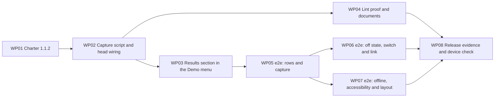

# Work Packages: On-page results mirror

**Inputs**: Design documents from `kitty-specs/on-page-results-mirror-01M78JHF/`
**Prerequisites**: plan.md (required), spec.md (user stories), research.md, data-model.md, contracts/, quickstart.md

**Tests**: The spec and plan explicitly require non-gate checks: `pnpm verify:results` (FR-014, SC-008) and a Results suite in `pnpm test:e2e` against the real snippet fixture (NFR-001 to NFR-003, SC-001 to SC-005, SC-007). They are planned here as their own work packages. The four gates (lint, build, no-secrets, provenance) are unchanged.

**Organization**: Subtasks (`Txxx`) roll up into work packages (`WPxx`). Each WP is independently deliverable and reviewable. Completion is recorded with `spec-kitty agent tasks mark-status Txxx --status done --mission on-page-results-mirror-01M78JHF`, never by editing this file.

**Prompt files**: Each WP links to a prompt in the flat `tasks/` directory.

**Rules for every WP**:

- **Secrets (QDR-004)**: the only container-ID-shaped literal allowed in any tracked file is `GTM-XXXXXXX`. Tests build every other ID while they run, for example `['GTM', 'SHOPE2E'].join('-')`.
- **No shop verdicts (FR-014, C-006)**: no file under `site/` holds a verdict mark or verdict wording. The lint rule that enforces this stays on for every file, including the capture file.
- **Console use**: allowed in `site/src/results/console-mirror.ts` only.
- **No new dependencies (C-005)**.

## Tasking decisions

These were settled while breaking the plan down. None changes the spec, the plan or a contract.

| Decision | Why |
|---|---|
| The lint override (`eslint.config.js`) ships in WP02 with the capture file, not with the verify script. | The capture file can't pass the lint gate without it, and every WP must pass `pnpm gates` on its own. The Charter amendment (WP01) goes first, so the exception is never ahead of the rulebook. |
| The shop-container e2e cases are split across two files: `e2e/results.spec.ts` (rows and capture) and `e2e/results-setting.spec.ts` (off state, switch, link, no pushes). The plan names one file. | Two files of about 6 cases each can be built in parallel with no shared ownership. |
| Shared e2e helpers live in a new file, `e2e/results-helpers.ts`, owned by WP05. | WP06 and WP07 import them, so neither edits `e2e/fixtures.ts`. |
| The Results section uses fixed class names and IDs (listed in WP03). | The e2e work packages can be written against them without reading WP03's code. |
| Entries that arrived before the menu module mounted are shown at once, and only the newest is announced. | The contract says results kept before mount are handed over (R-10) but doesn't say how many announcements that makes. One avoids a burst at page load. |
| "ES5-safe" in the capture file is met with `var`, `function` and `arguments`, using file-level lint disables for `no-var` and `prefer-rest-params` only. | The config override stays exactly as the plan and Charter 1.1.2 describe it: `no-console` off for one file. |

## Dependency graph

## Subtask Index (reference only)

| ID | Description | WP | Parallel |
|----|-------------|----|----------|
| T001 | Charter header: version 1.1.2 and amended date | WP01 | |
| T002 | New last bullet in "Verification that proves something" | WP01 | |
| T003 | New row in "How the Charter is enforced" and new amendment-log row | WP01 | |
| T004 | `charter.yaml` agreement check, gates, commit message with the reasoning | WP01 | |
| T005 | `console-mirror.ts`: the on/off decision; off leaves the page untouched | WP02 | |
| T006 | On path: remember the setting, `<html>` attributes, `window.__demoShopResults` and its type | WP02 | |
| T007 | Wrap six Console methods: original first, copy step in `try`/`catch` | WP02 | |
| T008 | Shape rules and text building: banner, plain line, group start | WP02 | |
| T009 | Result lifecycle: lines, pushed text, foreign groups, group end, limit of 50, listener | WP02 | |
| T010 | Lint: `no-console` off for the one file; the file lint-clean and ES5-safe | WP02 | |
| T011 | `vite.config.ts`: inline the capture script first, with build guards | WP02 | |
| T012 | Manual build check: off, on, offline order, dev server | WP02 | |
| T013 | `results-setting.ts`: guarded write, clear, probe and the address without `results` | WP03 | [P] |
| T014 | `results.ts`: section, switch, note and the storage-blocked state | WP03 | |
| T015 | Empty states and listening to the capture state | WP03 | |
| T016 | Rows: `details` per result, plain lines, text only, newest first | WP03 | |
| T017 | Own status region; announce without moving focus | WP03 | |
| T018 | Mount under the playground in `visitor-menu.ts`; guidance copy | WP03 | |
| T019 | Styles: wrapping at 360 px and 44 px targets | WP03 | [P] |
| T020 | `verify-results.ts`: the Console rule fires outside the capture file and not inside it | WP04 | |
| T021 | Verify the override covers exactly one file and the verdict-wording rule stays on there | WP04 | |
| T022 | Verify the capture file is self-contained and its key matches `results-setting.ts` | WP04 | |
| T023 | `package.json`: the `verify:results` script | WP04 | |
| T024 | `AGENTS.md`: code rule and Commands table | WP04 | [P] |
| T025 | `README.md`: operator notes for the Results view and the phone link | WP04 | [P] |
| T026 | `snippets.ts` script-body helper; `results-helpers.ts`: serve the snippet as `gtm.js`, turn the view on, wait for the banner | WP05 | |
| T027 | Helpers: Console capture with raw arguments, and expected text built from them | WP05 | |
| T028 | 7 presses: one row each, text equal to the Console group, newest first | WP05 | |
| T029 | The two empty states, checked against each other | WP05 | [P] |
| T030 | Other scripts' output stays out; plain-line rows; markup shown as text | WP05 | [P] |
| T031 | Console records equal with the view on and off; limit of 50 | WP05 | [P] |
| T032 | Off state on 5 pages with its control: native Console methods, same requests | WP06 | |
| T033 | Switch on and off: remembered, reloads, next page on and empty | WP06 | |
| T034 | Link: on as the switch; other values change nothing; beside `?scenario=` | WP06 | [P] |
| T035 | 3 crafted links with a container-shaped parameter never change the container | WP06 | [P] |
| T036 | Storage blocked: link on for one page, switch disabled with its note, off still works | WP06 | [P] |
| T037 | The view makes 0 pushes; a playground press makes its 2 entries | WP06 | [P] |
| T038 | Storage and requests unchanged with 7 results showing | WP06 | [P] |
| T039 | `playwright.config.ts`: route `results-offline.spec.ts` to the offline project | WP07 | |
| T040 | `results-offline.spec.ts`: 7 verbatim rows in the offline build; banner seen from the head | WP07 | |
| T041 | `a11y.spec.ts`: axe with the view on, empty and with results | WP07 | [P] |
| T042 | Keyboard reach of switch and rows; status region and focus for 7 of 7 presses | WP07 | [P] |
| T043 | `layout.spec.ts`: 0 px overflow at 360 px with 5 results, 2 expanded | WP07 | [P] |
| T044 | Full `pnpm test:e2e` run, flake check and evidence | WP07 | |
| T045 | Gates and checks on the merged tree; record in `docs/release-checks.md` | WP08 | |
| T046 | Lighthouse mobile LCP with the view off (NFR-004) | WP08 | |
| T047 | Device-check pack: preview address, QR link, steps and record table | WP08 | |
| T048 | Record the Product Owner's iPhone and Android results (FR-017, SC-006) | WP08 | |
| T049 | C-004 merge-timing record and sign-off table | WP08 | |

---

## Phase 1 – Rulebook

### WP01 – Charter 1.1.2 (Priority: P0)

**Goal**: Amend the Charter (patch) to say the shop may repeat the runtime's Console output on the page, word for word, and still never judges a push. Apply `contracts/charter-amendment.md` as written.
**Independent Test**: `charter.md` reads version 1.1.2 with today's amended date; the new bullet, enforcement row and amendment-log row match the contract word for word; the Policy Summary, Terminology Canon, Code Review Checklist and Regression Vigilance headings are unchanged; `charter.yaml` agrees; `pnpm gates` passes.
**Prompt**: `tasks/WP01-charter-1-1-2.md`
**Estimated prompt size**: ~220 lines
**Requirements**: FR-015, FR-014, C-003

**Included subtasks**:
T001 Charter header: version 1.1.2 and amended date (WP01)
T002 New last bullet in "Verification that proves something" (WP01)
T003 New row in "How the Charter is enforced" and new amendment-log row (WP01)
T004 `charter.yaml` agreement check, gates, commit message with the reasoning (WP01)

**Implementation sketch**: Four small edits to `charter.md` in one pass, then confirm `charter.yaml` needs no wording change and records no version. Commit with the reasoning the contract gives.
**Parallel opportunities**: None; short and sequential.
**Dependencies**: None. Goes first.
**Risks**: Rewording the contract's text; renaming a heading Spec Kitty reads; a commit message without the reasoning (QDR-007).

---

## Phase 2 – Capture

### WP02 – Capture script and head wiring (Priority: P0)

**Goal**: A self-contained inline head script that decides whether the Results view is on before any other script runs and, when on, copies Console calls that have the shape of Console output format v1 without changing what the Console receives. Wire it into the `quadrano-gtm` Vite plugin before the offline boot step and the GTM loader.
**Independent Test**: With the view off, `console.log` is native code on a built page, `<html>` has no `data-results-view`, and `window.__demoShopResults` is undefined. With `?results=on`, the six methods are wrapped, the attribute is set, and synthetic calls in the runtime's shape produce entries while other calls don't. In the offline build the capture script precedes the offline boot step. `pnpm gates` passes.
**Prompt**: `tasks/WP02-capture-script-and-head-wiring.md`
**Estimated prompt size**: ~520 lines
**Requirements**: FR-003, FR-005, FR-006, FR-007, FR-008, FR-009, FR-011, FR-014, C-001, C-002, C-006

**Included subtasks**:
T005 `console-mirror.ts`: the on/off decision; off leaves the page untouched (WP02)
T006 On path: remember the setting, `<html>` attributes, `window.__demoShopResults` and its type (WP02)
T007 Wrap six Console methods: original first, copy step in `try`/`catch` (WP02)
T008 Shape rules and text building: banner, plain line, group start (WP02)
T009 Result lifecycle: lines, pushed text, foreign groups, group end, limit of 50, listener (WP02)
T010 Lint: `no-console` off for the one file; the file lint-clean and ES5-safe (WP02)
T011 `vite.config.ts`: inline the capture script first, with build guards (WP02)
T012 Manual build check: off, on, offline order, dev server (WP02)

**Implementation sketch**: Write the file as one IIFE in ES5-style TypeScript. Decide on/off; return early when off. When on: set attributes, define the state object, wrap the methods, run the shape rules. Add the one-file lint override. In `vite.config.ts`, type-strip the file as `active-container.ts` is, guard it, and emit it first at the head marker.
**Parallel opportunities**: None inside the WP; the pieces build on each other.
**Dependencies**: WP01.
**Risks**: The script placed after the offline boot step (offline never sees the banner); a throw in the copy step reaching the caller; the lint override widened; a verdict mark typed into the file.

---

## Phase 3 – The view

### WP03 – Results section in the Demo menu (Priority: P1)

**Goal**: The Results section directly under the Event playground: the switch with its note, the two empty states, one row per result (newest first), plain-line rows, and a status region of its own. Update the menu's guidance copy.
**Independent Test**: With `?results=on` and Quadrano on the page, each playground press adds one row at the top whose text matches the Console group; the switch turns the view off by loading the address without `results`; with the view off the section holds only the heading, the switch and its note; nothing in the section makes a push.
**Prompt**: `tasks/WP03-results-section-in-demo-menu.md`
**Estimated prompt size**: ~480 lines
**Requirements**: FR-001, FR-002, FR-004, FR-006, FR-010, FR-012, FR-013, FR-016, NFR-001, NFR-002

**Included subtasks**:
T013 `results-setting.ts`: guarded write, clear, probe and the address without `results` (WP03)
T014 `results.ts`: section, switch, note and the storage-blocked state (WP03)
T015 Empty states and listening to the capture state (WP03)
T016 Rows: `details` per result, plain lines, text only, newest first (WP03)
T017 Own status region; announce without moving focus (WP03)
T018 Mount under the playground in `visitor-menu.ts`; guidance copy (WP03)
T019 Styles: wrapping at 360 px and 44 px targets (WP03)

**Implementation sketch**: `results-setting.ts` first (pure storage and address helpers). Then `results.ts` following the pattern of `playground.ts`: one `mountResults` function. Then two small edits in `visitor-menu.ts` and the styles.
**Parallel opportunities**: T013 and T019 touch their own files.
**Dependencies**: WP02 (the page interface and its type).
**Risks**: "Off" done with a plain reload while the address still carries `?results=on`; sharing the layout's live region; any Console text set as markup.

---

### WP04 – Lint proof and documents (Priority: P1)

**Goal**: Prove the Console rule still fires everywhere except the capture file (`pnpm verify:results`), and bring `AGENTS.md` and `README.md` in line with the Results view.
**Independent Test**: `pnpm verify:results` exits 0 on the tree; it exits non-zero when the override in `eslint.config.js` is widened to `site/src/results/**` or when an `import` is added to the capture file (both probed and reverted). `AGENTS.md` carries the new code rule and command; `README.md` explains the phone link.
**Prompt**: `tasks/WP04-lint-proof-and-documents.md`
**Estimated prompt size**: ~380 lines
**Requirements**: FR-014, FR-015, FR-016, SC-008, C-005

**Included subtasks**:
T020 `verify-results.ts`: the Console rule fires outside the capture file and not inside it (WP04)
T021 Verify the override covers exactly one file and the verdict-wording rule stays on there (WP04)
T022 Verify the capture file is self-contained and its key matches `results-setting.ts` (WP04)
T023 `package.json`: the `verify:results` script (WP04)
T024 `AGENTS.md`: code rule and Commands table (WP04)
T025 `README.md`: operator notes for the Results view and the phone link (WP04)

**Implementation sketch**: Follow `scripts/verify-container.ts` (a list of named checks, `ok` / `not ok` lines). Use ESLint's Node API to lint text in memory under two paths. Then the two documents.
**Parallel opportunities**: T024 and T025 are independent of the script.
**Dependencies**: WP02 (the capture file and the override exist).
**Risks**: A check that can't fail; a fixture on disk under `site/` that breaks `pnpm lint`; in-memory typed linting not accepting replaced text (fallback in research R-08).

---

## Phase 4 – Proof

### WP05 – e2e: rows and capture (Priority: P1)

**Goal**: Prove, against the real snippet fixture served on the shop's container path, that each push gives one row whose text equals the Console group, that both empty states work, that other scripts' output stays out, and that the Console receives the same calls with the view on and off.
**Independent Test**: `pnpm exec playwright test e2e/results.spec.ts --project=chromium` passes 3 times running; changing one character of a format string in a scratch copy of the fixture makes the verbatim test fail.
**Prompt**: `tasks/WP05-e2e-rows-and-capture.md`
**Estimated prompt size**: ~460 lines
**Requirements**: NFR-003, SC-001, FR-002, FR-003, FR-007, FR-008, FR-010

**Included subtasks**:
T026 `snippets.ts` script-body helper; `results-helpers.ts`: serve the snippet as `gtm.js`, turn the view on, wait for the banner (WP05)
T027 Helpers: Console capture with raw arguments, and expected text built from them (WP05)
T028 7 presses: one row each, text equal to the Console group, newest first (WP05)
T029 The two empty states, checked against each other (WP05)
T030 Other scripts' output stays out; plain-line rows; markup shown as text (WP05)
T031 Console records equal with the view on and off; limit of 50 (WP05)

**Implementation sketch**: Helpers first, since WP06 and WP07 import them. Then one test per check in `contracts/console-capture.md` and `contracts/results-view.md` that concerns rows.
**Parallel opportunities**: T029 to T031 are independent tests once the helpers exist.
**Dependencies**: WP03.
**Risks**: Expected text typed into the test (it then can't catch a format change); random transaction IDs breaking the on/off comparison.

---

### WP06 – e2e: off state, switch and link (Priority: P1)

**Goal**: Prove the off state with its control, the switch, the link, the container rule, the no-push rule and "nothing leaves the page".
**Independent Test**: `pnpm exec playwright test e2e/results-setting.spec.ts --project=chromium` passes 3 times running; each "nothing changed" check has its paired control in the same test.
**Prompt**: `tasks/WP06-e2e-off-state-switch-and-link.md`
**Estimated prompt size**: ~430 lines
**Requirements**: SC-002, SC-003, SC-004, FR-004, FR-005, FR-006, FR-011, FR-012, C-002

**Included subtasks**:
T032 Off state on 5 pages with its control: native Console methods, same requests (WP06)
T033 Switch on and off: remembered, reloads, next page on and empty (WP06)
T034 Link: on as the switch; other values change nothing; beside `?scenario=` (WP06)
T035 3 crafted links with a container-shaped parameter never change the container (WP06)
T036 Storage blocked: link on for one page, switch disabled with its note, off still works (WP06)
T037 The view makes 0 pushes; a playground press makes its 2 entries (WP06)
T038 Storage and requests unchanged with 7 results showing (WP06)

**Implementation sketch**: One new spec file. Each test states its control in its name or a comment.
**Parallel opportunities**: All tests are independent.
**Dependencies**: WP05 (helpers).
**Risks**: A ratchet check without its control passes on a build with no Results view at all.

---

### WP07 – e2e: offline build, accessibility and layout (Priority: P1)

**Goal**: Prove the verbatim rows in the offline build, 0 axe violations with the view on, keyboard reach, announcements without focus movement, and 0 px overflow at 360 px.
**Independent Test**: `pnpm test:e2e` passes in full, 3 times running, with the new offline suite in the `offline` project and the widened a11y and layout matrices in `chromium`.
**Prompt**: `tasks/WP07-e2e-offline-accessibility-and-layout.md`
**Estimated prompt size**: ~420 lines
**Requirements**: FR-009, FR-013, NFR-001, NFR-002, NFR-003, SC-005, SC-007

**Included subtasks**:
T039 `playwright.config.ts`: route `results-offline.spec.ts` to the offline project (WP07)
T040 `results-offline.spec.ts`: 7 verbatim rows in the offline build; banner seen from the head (WP07)
T041 `a11y.spec.ts`: axe with the view on, empty and with results (WP07)
T042 Keyboard reach of switch and rows; status region and focus for 7 of 7 presses (WP07)
T043 `layout.spec.ts`: 0 px overflow at 360 px with 5 results, 2 expanded (WP07)
T044 Full `pnpm test:e2e` run, flake check and evidence (WP07)

**Implementation sketch**: Config first, then the offline suite, then additions to the two existing specs without changing their existing cases.
**Parallel opportunities**: T041 to T043 touch different files.
**Dependencies**: WP05 (helpers).
**Risks**: The offline suite also running in `chromium` against the wrong server; existing matrices changed instead of extended.

---

## Phase 5 – Release evidence

### WP08 – Release evidence and device check (Priority: P1)

**Goal**: Record the gates and checks on the merged tree, page speed with the view off, and the real-device check that decides whether the mission reaches `main` before the talk (C-004).
**Independent Test**: `docs/release-checks.md` has a dated section for this mission with the command results, the Lighthouse table, the device-check table (filled in, or marked "not yet run" with the exact remaining steps) and a C-004 line that follows from it.
**Prompt**: `tasks/WP08-release-evidence-and-device-check.md`
**Estimated prompt size**: ~300 lines
**Requirements**: FR-017, SC-006, SC-008, NFR-004, C-004

**Included subtasks**:
T045 Gates and checks on the merged tree; record in `docs/release-checks.md` (WP08)
T046 Lighthouse mobile LCP with the view off (NFR-004) (WP08)
T047 Device-check pack: preview address, QR link, steps and record table (WP08)
T048 Record the Product Owner's iPhone and Android results (FR-017, SC-006) (WP08)
T049 C-004 merge-timing record and sign-off table (WP08)

**Implementation sketch**: Run and record what an agent can run. Prepare the device check so the Product Owner can do it in a few minutes. Record their results only as they report them.
**Parallel opportunities**: None; one file.
**Dependencies**: WP04, WP06, WP07.
**Risks**: Claiming a device check that hasn't happened; the mission merging before the talk without the record.

---

## Requirement coverage

| WP | Requirements |
|---|---|
| WP01 | FR-015, FR-014, C-003 |
| WP02 | FR-003, FR-005, FR-006, FR-007, FR-008, FR-009, FR-011, FR-014, C-001, C-002, C-006 |
| WP03 | FR-001, FR-002, FR-004, FR-006, FR-010, FR-012, FR-013, FR-016, NFR-001, NFR-002 |
| WP04 | FR-014, FR-015, FR-016, SC-008, C-005 |
| WP05 | NFR-003, SC-001, FR-002, FR-003, FR-007, FR-008, FR-010 |
| WP06 | SC-002, SC-003, SC-004, FR-004, FR-005, FR-006, FR-011, FR-012, C-002 |
| WP07 | FR-009, FR-013, NFR-001, NFR-002, NFR-003, SC-005, SC-007 |
| WP08 | FR-017, SC-006, SC-008, NFR-004, C-004 |

## MVP scope

WP01 to WP03 give a working Results view. WP05 is the first proof that its text is the runtime's. Nothing reaches `main` before the talk without WP08's device record (C-004).
